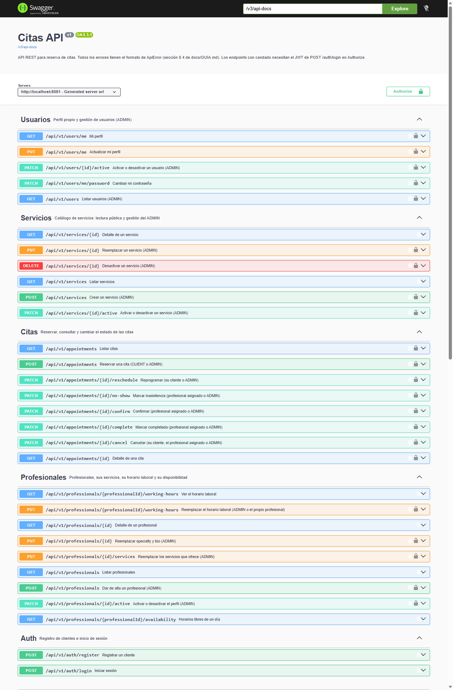

# Citas API

Un programa que lleva la agenda de un negocio que atiende con cita previa: servicios, profesionales, horarios y reservas.

Es una API (la forma en que dos programas se hablan): otro programa le pide datos y ella responde.


*Swagger UI: el título Citas API y los cinco grupos de operaciones que se pueden probar.*

## ¿Qué es?

Guarda los servicios y horarios de cada profesional, y calcula sus horas libres. Nunca deja reservar dos veces la misma hora de un profesional.

No trae pantallas propias: se prueba con Swagger UI (una página para probar una API con botones).

**Para quién es.** Negocios que atienden con cita previa, como un consultorio o una barbería.

## Qué puedes hacer

- **Consultar el catálogo.** Servicios, precios y quién los atiende.
- **Reservar una cita.** En una hora libre, desde una hora antes hasta 60 días después.
- **Cancelar o cambiar una cita.** El cliente cancela hasta 2 horas antes.
- **Llevar la agenda.** El profesional confirma citas y marca si el cliente asistió.
- **Administrar el negocio.** El administrador gestiona servicios, profesionales, horarios y usuarios.

## Cómo probarlo en tu computador

### Antes de empezar

> **Qué es la terminal.** Una ventana donde se escriben órdenes. En Windows, busca "PowerShell" en el menú Inicio. En Mac, busca "Terminal" con ⌘ + espacio.
>
> **Cómo usarla.** Copia la orden de esta página (el README). Pégala en la ventana con Ctrl + V (las teclas Control y V a la vez; en Mac, ⌘ + V). Luego pulsa Enter. No necesitas entenderla: cópiala tal cual. Si algo sale mal, aparece un mensaje que suele incluir la palabra «error».

Necesitas tener instalado:

| Programa | Para qué sirve | Cómo saber si ya lo tienes |
|---|---|---|
| [Docker Desktop](https://www.docker.com/products/docker-desktop/) | Prepara la API y su base de datos (donde guarda su información). | Escribe `docker compose version` en la terminal: debe aparecer un número de versión. |

Si te falta algún programa, descárgalo desde su enlace, ábrelo y sigue los pasos del instalador.

### Pasos

1. **Descarga el proyecto.** En la página de este proyecto en GitHub (donde estás leyendo esto), pulsa el botón verde **Code**. Luego elige **Download ZIP**. Se descarga un archivo comprimido (.zip): haz clic derecho sobre él y elige **Extraer todo**. Se crea una carpeta con el mismo nombre: esa es la carpeta del proyecto.
   La página es [github.com/banna-nuel/API-reserva-citas](https://github.com/banna-nuel/API-reserva-citas).

2. **Abre la terminal en la carpeta del proyecto.** Es la que tiene el archivo `docker-compose.yml`. Escribe `cd` (la orden para entrar a una carpeta) y un espacio. Arrastra la carpeta a la ventana y pulsa Enter.
   Vas bien si ves el nombre de la carpeta.

3. **Crea tu archivo de configuración.** El archivo `.env` guarda tu configuración privada. En la terminal, escribe:
   ```
   cp .env.example .env
   ```
   Vas bien si no aparece ningún mensaje de error.

4. **Genera tu clave secreta.** La API la usa para proteger cada inicio de sesión. En la terminal de Windows:
   ```
   $b = New-Object byte[] 32; [Security.Cryptography.RandomNumberGenerator]::Create().GetBytes($b); [Convert]::ToBase64String($b)
   ```
   En la de Mac:
   ```
   openssl rand -base64 32
   ```
   Vas bien si aparece una línea que termina en `=`. Cópiala.

5. **Abre el archivo `.env`.** En la terminal de Windows:
   ```
   notepad .env
   ```
   En la de Mac:
   ```
   open -e .env
   ```
   Vas bien si se abre un texto que empieza por `# Aplicación`.

6. **Cambia estas líneas de ejemplo.**

   | Línea | Qué hacer |
   |---|---|
   | `# SPRING_PROFILES_ACTIVE=dev` | Enciende Swagger UI: borra el `#` y el espacio. |
   | `DB_PASS=cambia-esta-clave` | Contraseña de la base de datos: `TU_CLAVE_BD`. |
   | `DB_ROOT_PASS=cambia-esta-clave-root` | Contraseña maestra de la base de datos; la API no la usa: `TU_CLAVE_ROOT`. |
   | `JWT_SECRET=PEGA_AQUI_EL_SECRETO` | Pega la clave del paso 4. |
   | `ADMIN_EMAIL=admin@example.com` | Correo del administrador: `TU_CORREO`. |
   | `ADMIN_PASSWORD=cambia-esta-clave` | Su contraseña, de 8 a 72 caracteres: `TU_CONTRASEÑA`. |

   Guarda con Ctrl + S (en Mac, ⌘ + S) y cierra.

7. **Enciende la API.** Con Docker Desktop abierto, escribe en la terminal:
   ```
   docker compose --profile app up -d --build
   ```
   La primera vez puede tardar unos minutos. Vas bien si no aparece ningún mensaje de error.

8. **Abre Swagger UI.** Escribe esta dirección en tu navegador (el programa con el que ves páginas web):
   ```
   http://localhost:8080/swagger-ui.html
   ```
   `localhost` es «este mismo computador» y 8080 es el puerto (la «puerta» de entrada). Solo funciona con la API encendida.
   Vas bien si ves una página con el título `Citas API`.

Para apagar la API, escribe en la terminal `docker compose --profile app down`. Sin `-v` al final, tus datos no se borran.

### ¿Cómo sé que funcionó?

Swagger UI muestra los grupos Usuarios, Servicios, Citas, Profesionales y Auth (autenticación: registro e inicio de sesión). El administrador ya existe, con los datos de tu `.env`.

Las operaciones con el ícono de un candado piden iniciar sesión. Para usarlas, abre `Iniciar sesión` y pega el `accessToken` de la respuesta en **Authorize**. Es un token (una contraseña temporal).

### Si algo falla

- **Docker Desktop no responde.** Ábrelo, espera a que arranque y repite el paso 7.
- **Swagger UI da error 404 (página no encontrada).** Quita el `#` de `SPRING_PROFILES_ACTIVE=dev` y repite el paso 7.
- **El puerto 8080 está ocupado.** En `.env`, cambia `APP_PORT=8080` por `APP_PORT=8081`, repite el paso 7 y usa 8081.

Para programar, lee [docs/desarrollo.md](docs/desarrollo.md): pruebas, variables, Postman (un programa para probar APIs) y problemas comunes. También explica cómo correr la API fuera de Docker Desktop. El diseño y las reglas de negocio están en [docs/GUIA.md](docs/GUIA.md).

## Estado del proyecto

Terminado (primera versión): funciona todo lo descrito arriba. Las mejoras futuras están en la guía, sección 18.

## Autor y licencia

Hecho por Emanuel ([Banna-nuel](https://github.com/Banna-nuel)).

Aún no tiene licencia definida (el permiso que dice qué pueden hacer otros con un proyecto). Para reutilizarlo, pide permiso a su autor.

## Palabras que quizá no conozcas

- **.env.** Un archivo de texto con la configuración privada del proyecto.
- **API.** La forma en que dos programas se hablan.
- **Archivo comprimido (ZIP).** Un archivo que guarda muchos archivos juntos y en menos espacio.
- **Autenticación.** Registrarse e iniciar sesión.
- **Base de datos.** El lugar donde la API guarda su información.
- **cd.** La orden para entrar a una carpeta desde la terminal.
- **Docker Desktop.** Un programa que prepara en tu computador todo lo que la API necesita.
- **Error 404.** El aviso de que una página no existe.
- **GitHub.** Una página web para guardar y compartir proyectos.
- **Licencia.** El permiso que dice qué pueden hacer otros con un proyecto.
- **localhost.** Tu propio computador funcionando como sitio web, solo para ti.
- **Navegador.** El programa con el que ves páginas web.
- **Postman.** Un programa para enviar peticiones a una API y ver sus respuestas.
- **Puerto.** El número de "puerta" por donde entra una conexión.
- **README.** El archivo que presenta un proyecto.
- **Swagger UI.** Una página para probar una API con botones.
- **Terminal.** Una ventana donde se escriben órdenes.
- **Token.** Una contraseña que usa un programa para identificarse.
