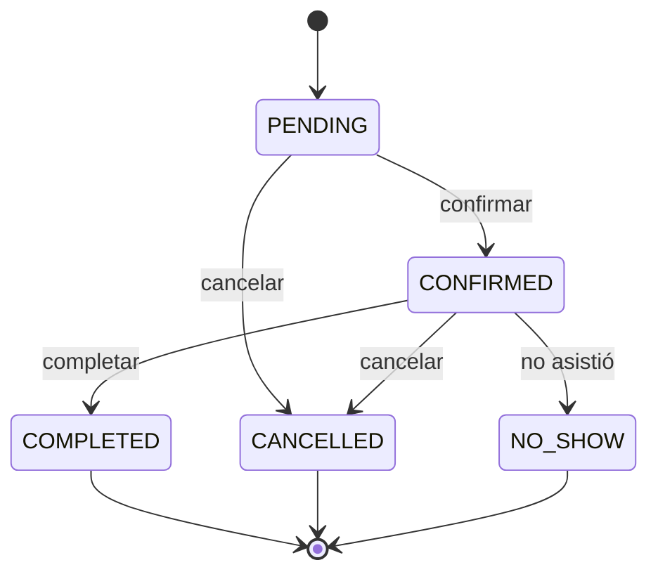
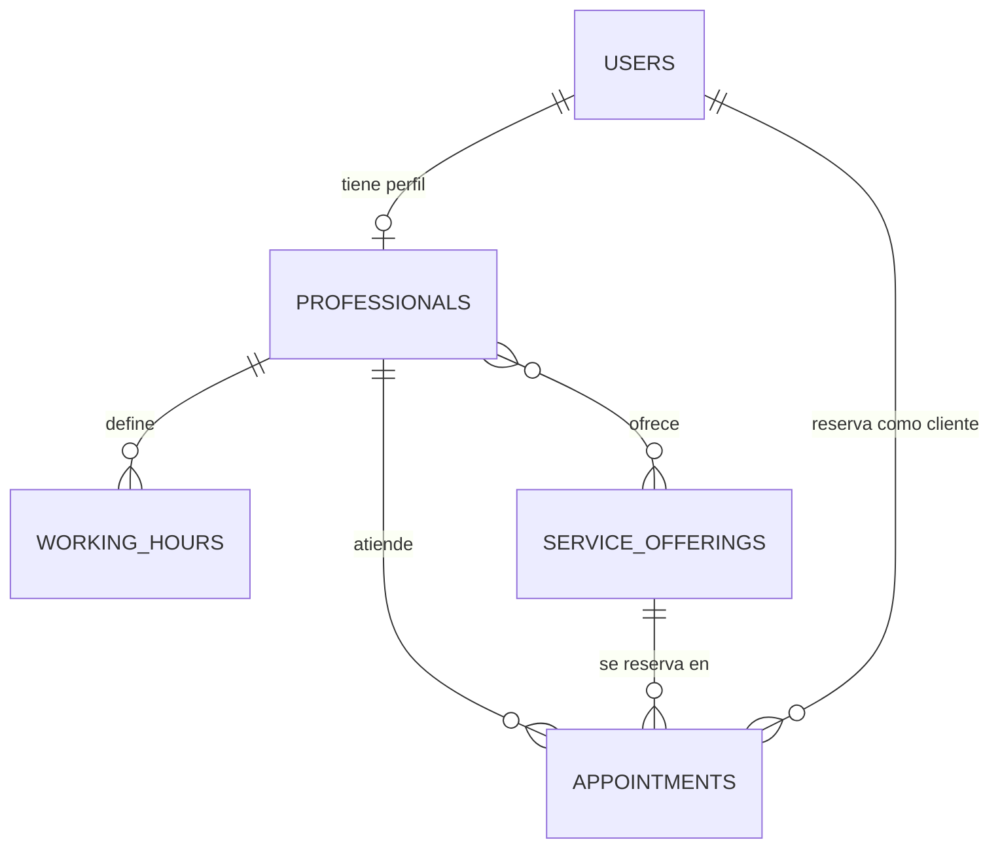

# Citas API — API REST para reserva de citas

Guía completa para diseñar, desarrollar, probar y desplegar una API de **reserva de citas** con **Java, Spring Boot, MySQL y Postman**.
Está escrita en el orden en que se desarrolla el proyecto: sigue las secciones de arriba hacia abajo y marca las casillas `- [ ]` conforme avances.

## Tabla de contenido

1. [Descripción general](#1-descripción-general)
2. [Stack tecnológico](#2-stack-tecnológico)
3. [Requisitos previos](#3-requisitos-previos)
4. [Requisitos y reglas de negocio](#4-requisitos-y-reglas-de-negocio)
5. [Modelo de datos](#5-modelo-de-datos)
6. [Arquitectura y estructura del proyecto](#6-arquitectura-y-estructura-del-proyecto)
7. [Configuración inicial](#7-configuración-inicial)
8. [Diseño de la API (contrato)](#8-diseño-de-la-api-contrato)
9. [Plan de desarrollo paso a paso](#9-plan-de-desarrollo-paso-a-paso)
10. [Guía de implementación (código de referencia)](#10-guía-de-implementación-código-de-referencia)
11. [Seguridad con JWT](#11-seguridad-con-jwt)
12. [Pruebas](#12-pruebas)
13. [Documentación con Swagger/OpenAPI](#13-documentación-con-swaggeropenapi)
14. [Despliegue y CI](#14-despliegue-y-ci)
15. [Buenas prácticas](#15-buenas-prácticas)
16. [Checklist final](#16-checklist-final)
17. [Problemas comunes](#17-problemas-comunes)
18. [Mejoras futuras](#18-mejoras-futuras)
19. [Referencias](#19-referencias)

---

## 1. Descripción general

API REST para gestionar reservas de citas en un negocio de servicios (consultorio, barbería, spa, canchas deportivas…).
Los **clientes** consultan servicios, profesionales y horarios libres, y reservan. Los **profesionales** administran su agenda. El **administrador** configura el catálogo.

| Rol | Qué puede hacer |
|---|---|
| `CLIENT` | Registrarse, ver catálogo y disponibilidad, reservar, cancelar y reprogramar sus citas |
| `PROFESSIONAL` | Ver su agenda, confirmar/completar citas, gestionar su horario laboral |
| `ADMIN` | Gestionar usuarios, servicios, profesionales y todas las citas |

**Alcance del MVP:** autenticación JWT, catálogo de servicios y profesionales, horarios laborales, cálculo de disponibilidad y ciclo de vida completo de la cita. Lo que queda fuera está en la [sección 18](#18-mejoras-futuras).

**Decisión de zona horaria:** las fechas de las citas se guardan como `LocalDateTime` y se interpretan en la zona horaria del negocio (`America/Bogota`, configurable). Si algún día atiendes en varios países, migra a `Instant`/UTC.

---

## 2. Stack tecnológico

| Componente | Versión recomendada | Notas |
|---|---|---|
| Java (JDK) | 21 LTS o 25 LTS | Mínimo 17 |
| Spring Boot | 4.1.x | Trae Spring Framework 7 y Spring Security 7 |
| MySQL | 8.4 LTS | Driver `com.mysql:mysql-connector-j` |
| Flyway | La que gestiona Spring Boot | Migraciones versionadas |
| springdoc-openapi | 3.1.x | Para Boot 4.1 (la línea 3.0.x es para Boot 4.0) |
| JJWT | 0.13.0 | Con `jjwt-gson` |
| Build | Maven (wrapper `mvnw`) | |
| Pruebas | JUnit 5, Mockito, Testcontainers | |
| Pruebas manuales | Postman | |
| Contenedores | Docker + Docker Compose | |

### Si sigues tutoriales de Spring Boot 3, cambia esto

| Tutorial (Boot 3) | Spring Boot 4 |
|---|---|
| `spring-boot-starter-web` | `spring-boot-starter-webmvc` |
| `flyway-core` | `spring-boot-starter-flyway` + `flyway-mysql` |
| `jjwt-jackson` | `jjwt-gson` (Boot 4 usa Jackson 3 y `jjwt-jackson` depende de Jackson 2) |
| springdoc 2.x | springdoc 3.x |
| `@MockBean` | `@MockitoBean` |
| `@WebMvcTest` en `org.springframework.boot.test.autoconfigure.web.servlet` | `org.springframework.boot.webmvc.test.autoconfigure` |

---

## 3. Requisitos previos

| Herramienta | Cómo verificar |
|---|---|
| JDK 21 o superior | `java -version` |
| Git | `git --version` |
| Docker Desktop | `docker --version` y `docker compose version` |
| Maven | Opcional: el proyecto incluye `mvnw` |
| IDE | IntelliJ IDEA, o VS Code con *Extension Pack for Java* y *Spring Boot Extension Pack* |
| Postman | La cuenta gratuita basta |
| Cliente SQL | DBeaver o MySQL Workbench |

---

## 4. Requisitos y reglas de negocio

### 4.1 Requisitos funcionales

- **Cliente:** RF-01 registrarse e iniciar sesión · RF-02 ver servicios y profesionales · RF-03 consultar horarios disponibles · RF-04 reservar una cita · RF-05 ver, cancelar y reprogramar sus citas.
- **Profesional:** RF-06 ver su agenda (por día, rango o estado) · RF-07 confirmar, completar o marcar inasistencia · RF-08 gestionar su horario laboral.
- **Administrador:** RF-09 CRUD de servicios · RF-10 alta de profesionales y asignación de servicios · RF-11 activar/desactivar usuarios · RF-12 ver y gestionar todas las citas.

### 4.2 Requisitos no funcionales

- **Seguridad:** JWT sin estado, contraseñas con BCrypt, autorización por rol, secretos fuera del código.
- **Consistencia:** nunca debe haber doble reserva, ni siquiera con peticiones simultáneas.
- **Calidad:** validación de entrada, errores con formato uniforme, paginación en listados.
- **Mantenibilidad:** arquitectura en capas, DTOs, migraciones versionadas, cobertura ≥ 70 % en servicios.
- **Documentación:** OpenAPI/Swagger y colección Postman versionada.
- **Portabilidad:** la base de datos se levanta con un solo comando (`docker compose up -d`).

### 4.3 Reglas de negocio

| ID | Regla |
|---|---|
| RN-01 | La duración de la cita la define el servicio: `fin = inicio + duración`. |
| RN-02 | Un profesional no puede tener dos citas activas (`PENDING`/`CONFIRMED`) solapadas. Hay solape si `nuevoInicio < existenteFin` **y** `nuevoFin > existenteInicio`. |
| RN-03 | La cita debe caber completa dentro de un bloque del horario laboral del profesional para ese día de la semana. Los bloques contiguos (el fin de uno es el inicio del siguiente, p. ej. `09:00-12:00` y `12:00-14:00`) cuentan como uno solo: la cita puede empezar en uno y terminar en el otro. Los horarios se ofrecen anclados al inicio de cada tramo, cada `slot-step-minutes` (un tramo que empieza a las 09:15 ofrece 09:15, 09:45…), y una cita debe empezar exactamente en uno de ellos. |
| RN-04 | Se reserva con una anticipación mínima (`min-notice-minutes`) y como máximo `max-days-ahead` días hacia adelante. |
| RN-05 | Servicio y profesional deben estar activos, y el profesional debe ofrecer ese servicio. |
| RN-06 | Un cliente no puede tener dos citas activas solapadas, ni siquiera con profesionales distintos. |
| RN-07 | Solo existen las transiciones del diagrama 4.4. `CANCELLED`, `COMPLETED` y `NO_SHOW` son estados finales. |
| RN-08 | El cliente cancela hasta `cancel-limit-hours` antes de la cita; profesional y admin, sin límite. |
| RN-09 | El precio se congela al reservar: si el servicio cambia de precio después, la cita no cambia. |
| RN-10 | Borrado lógico: usuarios, profesionales y servicios se desactivan (`active = false`), no se eliminan. |
| RN-11 | Email único (se guarda en minúsculas). Contraseña de 8 a 72 caracteres (BCrypt solo usa los primeros 72 bytes). |
| RN-12 | Reprogramar = volver a validar RN-02 a RN-06 excluyendo la propia cita. |
| RN-13 | Cada usuario opera solo sobre lo suyo: el cliente sobre sus citas, el profesional sobre las de su agenda. Si no le pertenece, responder 404 (no revelar que existe). |

### 4.4 Ciclo de vida de la cita



---

## 5. Modelo de datos



Guarda este script como `src/main/resources/db/migration/V1__create_schema.sql`.
**Regla de oro de Flyway:** una migración ya aplicada no se edita nunca. Cualquier cambio posterior va en una migración nueva (`V2__...`, `V3__...`).

```sql
CREATE TABLE users (
    id            BIGINT       NOT NULL AUTO_INCREMENT,
    full_name     VARCHAR(120) NOT NULL,
    email         VARCHAR(150) NOT NULL,
    password_hash VARCHAR(100) NOT NULL,                 -- hash BCrypt
    phone         VARCHAR(30),
    role          VARCHAR(20)  NOT NULL,                 -- ADMIN | PROFESSIONAL | CLIENT
    active        BOOLEAN      NOT NULL DEFAULT TRUE,
    created_at    DATETIME(6)  NOT NULL DEFAULT CURRENT_TIMESTAMP(6),
    updated_at    DATETIME(6)  NOT NULL DEFAULT CURRENT_TIMESTAMP(6) ON UPDATE CURRENT_TIMESTAMP(6),
    PRIMARY KEY (id),
    CONSTRAINT uq_users_email UNIQUE (email)
);

CREATE TABLE professionals (
    id         BIGINT       NOT NULL AUTO_INCREMENT,
    user_id    BIGINT       NOT NULL,
    specialty  VARCHAR(100) NOT NULL,
    bio        VARCHAR(500),
    active     BOOLEAN      NOT NULL DEFAULT TRUE,
    created_at DATETIME(6)  NOT NULL DEFAULT CURRENT_TIMESTAMP(6),
    updated_at DATETIME(6)  NOT NULL DEFAULT CURRENT_TIMESTAMP(6) ON UPDATE CURRENT_TIMESTAMP(6),
    PRIMARY KEY (id),
    CONSTRAINT uq_professionals_user UNIQUE (user_id),
    CONSTRAINT fk_professionals_user FOREIGN KEY (user_id) REFERENCES users (id)
);

CREATE TABLE service_offerings (
    id               BIGINT        NOT NULL AUTO_INCREMENT,
    name             VARCHAR(100)  NOT NULL,
    description      VARCHAR(500),
    duration_minutes INT           NOT NULL,
    price            DECIMAL(10,2) NOT NULL,
    active           BOOLEAN       NOT NULL DEFAULT TRUE,
    created_at       DATETIME(6)   NOT NULL DEFAULT CURRENT_TIMESTAMP(6),
    updated_at       DATETIME(6)   NOT NULL DEFAULT CURRENT_TIMESTAMP(6) ON UPDATE CURRENT_TIMESTAMP(6),
    PRIMARY KEY (id),
    CONSTRAINT uq_service_offerings_name UNIQUE (name),
    CONSTRAINT ck_service_duration CHECK (duration_minutes > 0),
    CONSTRAINT ck_service_price CHECK (price >= 0)
);

CREATE TABLE professional_services (                     -- relación N:M
    professional_id BIGINT NOT NULL,
    service_id      BIGINT NOT NULL,
    PRIMARY KEY (professional_id, service_id),
    CONSTRAINT fk_ps_professional FOREIGN KEY (professional_id) REFERENCES professionals (id),
    CONSTRAINT fk_ps_service      FOREIGN KEY (service_id)      REFERENCES service_offerings (id)
);

CREATE TABLE working_hours (                             -- varios bloques por día (p. ej. pausa de almuerzo)
    id              BIGINT      NOT NULL AUTO_INCREMENT,
    professional_id BIGINT      NOT NULL,
    day_of_week     VARCHAR(10) NOT NULL,                -- MONDAY … SUNDAY (java.time.DayOfWeek)
    start_time      TIME        NOT NULL,
    end_time        TIME        NOT NULL,
    PRIMARY KEY (id),
    CONSTRAINT ck_wh_range CHECK (end_time > start_time),
    CONSTRAINT fk_wh_professional FOREIGN KEY (professional_id) REFERENCES professionals (id),
    INDEX idx_wh_professional_day (professional_id, day_of_week)
);

CREATE TABLE appointments (
    id              BIGINT        NOT NULL AUTO_INCREMENT,
    client_id       BIGINT        NOT NULL,
    professional_id BIGINT        NOT NULL,
    service_id      BIGINT        NOT NULL,
    start_time      DATETIME      NOT NULL,
    end_time        DATETIME      NOT NULL,
    status          VARCHAR(20)   NOT NULL DEFAULT 'PENDING',
    price           DECIMAL(10,2) NOT NULL,              -- precio congelado al reservar (RN-09)
    notes           VARCHAR(500),
    cancel_reason   VARCHAR(255),
    created_at      DATETIME(6)   NOT NULL DEFAULT CURRENT_TIMESTAMP(6),
    updated_at      DATETIME(6)   NOT NULL DEFAULT CURRENT_TIMESTAMP(6) ON UPDATE CURRENT_TIMESTAMP(6),
    PRIMARY KEY (id),
    CONSTRAINT ck_appt_range CHECK (end_time > start_time),
    CONSTRAINT fk_appt_client       FOREIGN KEY (client_id)       REFERENCES users (id),
    CONSTRAINT fk_appt_professional FOREIGN KEY (professional_id) REFERENCES professionals (id),
    CONSTRAINT fk_appt_service      FOREIGN KEY (service_id)      REFERENCES service_offerings (id),
    INDEX idx_appt_professional_time (professional_id, start_time, end_time),
    INDEX idx_appt_client_time (client_id, start_time),
    INDEX idx_appt_status (status)
);
```

---

## 6. Arquitectura y estructura del proyecto

### Flujo de una petición

```
Cliente (Postman / front)
   │  HTTP + JSON
   ▼
Filtro JWT ──► SecurityConfig  (¿autenticado? ¿rol permitido?)
   ▼
Controller    valida el DTO (@Valid), llama al servicio, devuelve el código HTTP
   ▼
Service       reglas de negocio, @Transactional, convierte entidad → DTO
   ▼
Repository    Spring Data JPA
   ▼
MySQL         esquema versionado con Flyway

(cualquier excepción) ──► GlobalExceptionHandler ──► JSON de error uniforme
```

### Reglas de dependencia

- `controller → service → repository`. El controlador nunca llama a un repositorio y el servicio no conoce HTTP (`HttpServletRequest`, `ResponseEntity`).
- **Las entidades JPA no salen del servicio**: se convierten a DTO dentro de la transacción. Con `open-in-view: false` esto evita `LazyInitializationException`.
- Las reglas de negocio viven en `service` (o en métodos de la entidad/enum, como `AppointmentStatus.canTransitionTo`).
- La organización es **por capas** (simple para empezar). Si el proyecto crece, puedes pasar a organización por módulo (`appointment/`, `professional/`…).
- La entidad de servicios se llama `ServiceOffering` (y no `Service`) para no confundirla con la anotación `@Service` de Spring. En la URL sigue siendo `/services`.

### Estructura de carpetas

```
citas-api/
├── .github/workflows/ci.yml
├── .env.example                  # plantilla de variables (el .env real NO se sube)
├── .gitignore
├── docker-compose.yml            # MySQL para desarrollo
├── Dockerfile
├── pom.xml
├── README.md
├── postman/
│   ├── citas-api.postman_collection.json
│   └── local.postman_environment.json
└── src
    ├── main
    │   ├── java/com/q/q
    │   │   ├── CitasApiApplication.java
    │   │   ├── config/        AppProperties, AppConfig (Clock), OpenApiConfig, SecurityConfig, AdminBootstrap
    │   │   ├── security/      AuthUser, CustomUserDetailsService, JwtService, JwtAuthenticationFilter,
    │   │   │                  RestAuthenticationEntryPoint, RestAccessDeniedHandler
    │   │   ├── controller/    AuthController, UserController, ServiceOfferingController,
    │   │   │                  ProfessionalController, AppointmentController
    │   │   ├── service/       AuthService, UserService, ServiceOfferingService, ProfessionalService,
    │   │   │                  WorkingHourService, AvailabilityService, AppointmentService
    │   │   ├── repository/    UserRepository, ProfessionalRepository, ServiceOfferingRepository,
    │   │   │                  WorkingHourRepository, AppointmentRepository
    │   │   ├── entity/        User, Professional, ServiceOffering, WorkingHour, Appointment
    │   │   │   └── enums/     Role, AppointmentStatus
    │   │   ├── dto/
    │   │   │   ├── request/   RegisterRequest, LoginRequest, CreateAppointmentRequest, ...
    │   │   │   └── response/  AuthResponse, UserResponse, AppointmentResponse, TimeSlot, PageResponse, ...
    │   │   ├── mapper/        AppointmentMapper, ProfessionalMapper, ...   (manuales o MapStruct)
    │   │   └── exception/     ApiException, ResourceNotFoundException, ConflictException,
    │   │                      BusinessRuleException, ForbiddenOperationException, ApiError,
    │   │                      GlobalExceptionHandler
    │   └── resources
    │       ├── application.yml
    │       ├── application-dev.yml
    │       ├── application-prod.yml
    │       └── db/migration/V1__create_schema.sql
    └── test/java/com/q/q
        ├── service/           pruebas unitarias (Mockito)
        ├── repository/        @DataJpaTest + Testcontainers
        ├── controller/        @WebMvcTest
        └── integration/       @SpringBootTest de extremo a extremo
```

---

## 7. Configuración inicial

### 7.1 Crear el proyecto en Initializr

Entra a <https://start.spring.io> y configura:

| Campo | Valor |
|---|---|
| Project | Maven |
| Language | Java |
| Spring Boot | 4.1.x (la última estable; evita SNAPSHOT y RC) |
| Group / Artifact | `com.bannanuel` / `citas-api` |
| Package name | `com.q.q` |
| Packaging / Java | Jar / 21 |
| Dependencies | Spring Web, Spring Data JPA, Validation, Spring Security, MySQL Driver, Flyway Migration, Lombok, Spring Boot Actuator, Testcontainers |

### 7.2 Dependencias

Con Boot 4 los starters son modulares. Verifica que tu `pom.xml` tenga estos (Initializr los agrega; revisa que `flyway-mysql` esté):

| Dependencia | Para qué |
|---|---|
| `spring-boot-starter-webmvc` | API REST con Spring MVC |
| `spring-boot-starter-data-jpa` | JPA/Hibernate y repositorios |
| `spring-boot-starter-validation` | Validación de DTOs (`@Valid`) |
| `spring-boot-starter-security` | Autenticación y autorización |
| `spring-boot-starter-flyway` + `org.flywaydb:flyway-mysql` | Migraciones de base de datos |
| `com.mysql:mysql-connector-j` (runtime) | Driver de MySQL |
| `spring-boot-starter-actuator` | `/actuator/health` |
| `org.projectlombok:lombok` | Menos código repetitivo |
| Pruebas: `spring-boot-starter-webmvc-test`, `spring-boot-starter-data-jpa-test`, `org.springframework.security:spring-security-test`, Testcontainers (MySQL) | Tests |

**Añade a mano** lo que Initializr no genera (springdoc y JWT):

```xml
<properties>
    <java.version>21</java.version>
    <jjwt.version>0.13.0</jjwt.version>
    <springdoc.version>3.1.0</springdoc.version>
</properties>

<dependencies>
    <dependency>
        <groupId>org.springdoc</groupId>
        <artifactId>springdoc-openapi-starter-webmvc-ui</artifactId>
        <version>${springdoc.version}</version>
    </dependency>
    <dependency>
        <groupId>io.jsonwebtoken</groupId>
        <artifactId>jjwt-api</artifactId>
        <version>${jjwt.version}</version>
    </dependency>
    <dependency>
        <groupId>io.jsonwebtoken</groupId>
        <artifactId>jjwt-impl</artifactId>
        <version>${jjwt.version}</version>
        <scope>runtime</scope>
    </dependency>
    <dependency>
        <groupId>io.jsonwebtoken</groupId>
        <artifactId>jjwt-gson</artifactId>
        <version>${jjwt.version}</version>
        <scope>runtime</scope>
    </dependency>
</dependencies>
```

### 7.3 Variables de entorno

Crea `.env.example` (este sí se sube al repositorio) y cópialo a `.env` (este **no** se sube; agrégalo al `.gitignore`).
No pongas comentarios al final de una línea de valor: van siempre en su propia línea.

```dotenv
# Aplicación
APP_PORT=8080

# Base de datos
DB_HOST=localhost
DB_PORT=3306
DB_NAME=citas_db
DB_USER=citas_user
DB_PASS=cambia-esta-clave
DB_ROOT_PASS=cambia-esta-clave-root

# JWT: genera el secreto con  openssl rand -base64 32  (mínimo 256 bits)
JWT_SECRET=PEGA_AQUI_EL_SECRETO
JWT_EXPIRATION_MINUTES=60

# Primer usuario administrador (se crea al arrancar si no existe)
ADMIN_EMAIL=admin@example.com
ADMIN_PASSWORD=cambia-esta-clave
```

`.gitignore` mínimo:

```
target/
.env
.idea/
*.iml
.vscode/
*.log
```

### 7.4 MySQL con Docker Compose

```yaml
# docker-compose.yml
services:
  mysql:
    image: mysql:8.4
    container_name: citas-mysql
    restart: unless-stopped
    environment:
      MYSQL_DATABASE: ${DB_NAME}
      MYSQL_USER: ${DB_USER}
      MYSQL_PASSWORD: ${DB_PASS}
      MYSQL_ROOT_PASSWORD: ${DB_ROOT_PASS}
      TZ: America/Bogota
    ports:
      - "3306:3306"
    volumes:
      - mysql_data:/var/lib/mysql
    healthcheck:
      test: ["CMD", "mysqladmin", "ping", "-h", "localhost"]
      interval: 10s
      timeout: 5s
      retries: 10

volumes:
  mysql_data:
```

### 7.5 `application.yml` y perfiles

Spring Boot **no** lee `.env` por sí solo. La línea `spring.config.import` de abajo lo carga (alternativa: define las variables en tu IDE o expórtalas en la terminal).

```yaml
# src/main/resources/application.yml
server:
  port: ${APP_PORT:8080}

spring:
  application:
    name: citas-api
  config:
    import: optional:file:.env[.properties]
  datasource:
    url: jdbc:mysql://${DB_HOST:localhost}:${DB_PORT:3306}/${DB_NAME:citas_db}
    username: ${DB_USER}
    password: ${DB_PASS}
  jpa:
    open-in-view: false            # evita consultas "ocultas" en la capa web
    hibernate:
      ddl-auto: validate           # el esquema lo manda Flyway, Hibernate solo valida
  data:
    web:
      pageable:
        default-page-size: 20
        max-page-size: 100

management:
  endpoints:
    web:
      exposure:
        include: health,info

app:
  timezone: America/Bogota
  jwt:
    secret: ${JWT_SECRET}
    expiration-minutes: ${JWT_EXPIRATION_MINUTES:60}
  booking:
    slot-step-minutes: 30          # cada cuántos minutos se ofrece un horario
    min-notice-minutes: 60         # anticipación mínima para reservar (RN-04)
    max-days-ahead: 60             # hasta cuántos días a futuro se puede reservar (RN-04)
    cancel-limit-hours: 2          # el cliente cancela hasta N horas antes (RN-08)
  admin:
    email: ${ADMIN_EMAIL:}
    password: ${ADMIN_PASSWORD:}
```

```yaml
# application-dev.yml  (SPRING_PROFILES_ACTIVE=dev)
spring:
  jpa:
    show-sql: true
logging:
  level:
    com.q.q: DEBUG
```

```yaml
# application-prod.yml
springdoc:
  api-docs:
    enabled: false
  swagger-ui:
    enabled: false
logging:
  level:
    root: INFO
```

### 7.6 Primera ejecución

```bash
cp .env.example .env                 # en Windows PowerShell: copy .env.example .env  (y edita los valores)
docker compose up -d                 # levanta MySQL
./mvnw spring-boot:run -Dspring-boot.run.profiles=dev     # Windows: .\mvnw.cmd spring-boot:run ...
```

- Salud: <http://localhost:8080/actuator/health> → `{"status":"UP"}`
- Swagger UI: <http://localhost:8080/swagger-ui.html>
- En MySQL deben existir las tablas de la sección 5 y la tabla `flyway_schema_history`.

---

## 8. Diseño de la API (contrato)

Define el contrato **antes** de programar. Esta sección es la fuente de verdad: si cambia un endpoint, se cambia aquí primero.

### 8.1 Convenciones

- Base URL: `/api/v1`. Formato JSON (UTF-8).
- Recursos en plural, minúsculas y con guiones: `/working-hours`. Sin verbos en la URL (excepto acciones de estado como `/cancel`).
- Fechas ISO-8601: fecha-hora `2026-11-05T10:00:00` (hora local del negocio), fecha `2026-11-05`, hora `09:00`.
- Autenticación: cabecera `Authorization: Bearer <token>`.
- Paginación y orden: `?page=0&size=20&sort=startTime,desc` (máximo `size=100`).
- Filtros como parámetros de consulta: `?status=CONFIRMED&from=2026-11-01&to=2026-11-30`.
- Números enteros en el body (`durationMinutes`, ids…): un valor con decimales, aunque sea `.0` (p. ej. `30.5` o `30.0`), da `400 MALFORMED_REQUEST`; no se redondea ni se trunca. Los importes (`price`) sí llevan decimales.

| Código | Cuándo |
|---|---|
| `200 OK` | Consulta o actualización exitosa |
| `201 Created` | Recurso creado (incluye cabecera `Location`) |
| `204 No Content` | Éxito sin cuerpo (p. ej. desactivar) |
| `400 Bad Request` | Validación fallida o JSON mal formado |
| `401 Unauthorized` | Sin token, token inválido/expirado o credenciales incorrectas |
| `403 Forbidden` | Autenticado, pero sin permiso por rol |
| `404 Not Found` | El recurso no existe (o no es tuyo, RN-13) |
| `409 Conflict` | Choque de estado: horario ocupado, email duplicado, transición inválida |
| `422 Unprocessable Entity` | Regla de negocio incumplida (fuera de horario, poca anticipación…) |
| `500 Internal Server Error` | Error inesperado (nunca exponer el stacktrace) |

### 8.2 Endpoints

**Auth**

| Método | Ruta | Descripción | Acceso | Éxito |
|---|---|---|---|---|
| POST | `/auth/register` | Registro de cliente | Público | 201 |
| POST | `/auth/login` | Inicia sesión y devuelve el JWT | Público | 200 |

**Usuarios**

| Método | Ruta | Descripción | Acceso | Éxito |
|---|---|---|---|---|
| GET | `/users/me` | Mi perfil | Autenticado | 200 |
| PUT | `/users/me` | Actualizar mi perfil (solo `fullName` y `phone`) | Autenticado | 200 |
| PATCH | `/users/me/password` | Cambiar mi contraseña (`currentPassword`, `newPassword`) | Autenticado | 204 |
| GET | `/users` | Listar usuarios (paginado; `?role=&page=&size=&sort=`) | ADMIN | 200 |
| PATCH | `/users/{id}/active` | Activar/desactivar usuario (`{ "active": false }`) | ADMIN | 200 |

El email y el rol de un usuario no se cambian por estos endpoints: el email es el `subject` del JWT y el rol lo asigna el alta (registro público → `CLIENT`, alta de profesional → `PROFESSIONAL`).

**Servicios**

| Método | Ruta | Descripción | Acceso | Éxito |
|---|---|---|---|---|
| GET | `/services` | Listar (paginado; `?q=texto&page=&size=&sort=`; el ADMIN también `?active=`) | Público | 200 |
| GET | `/services/{id}` | Detalle (uno inactivo da 404, salvo al ADMIN) | Público | 200 |
| POST | `/services` | Crear | ADMIN | 201 |
| PUT | `/services/{id}` | Reemplazar `name`, `description`, `durationMinutes` y `price` (no cambia `active`) | ADMIN | 200 |
| DELETE | `/services/{id}` | Desactivar (borrado lógico, RN-10; idempotente) | ADMIN | 204 |
| PATCH | `/services/{id}/active` | Activar/desactivar (`{ "active": true }`) | ADMIN | 200 |

Sin token o con un rol distinto de ADMIN, las lecturas solo muestran servicios activos.

**Profesionales**

| Método | Ruta | Descripción | Acceso | Éxito |
|---|---|---|---|---|
| GET | `/professionals` | Listar (paginado; `?serviceId=&page=&size=&sort=`; el ADMIN también `?active=`) | Público | 200 |
| GET | `/professionals/{id}` | Detalle (con el perfil o el usuario inactivo da 404, salvo al ADMIN) | Público | 200 |
| POST | `/professionals` | Crea el usuario (rol PROFESSIONAL) y su perfil en una transacción | ADMIN | 201 |
| PUT | `/professionals/{id}` | Reemplazar `specialty` y `bio` (no cambia `active` ni los datos del usuario) | ADMIN | 200 |
| PATCH | `/professionals/{id}/active` | Activar/desactivar el perfil (`{ "active": false }`) | ADMIN | 200 |
| PUT | `/professionals/{id}/services` | Reemplazar los servicios que ofrece (`{ "serviceIds": [1, 2] }`) | ADMIN | 200 |
| GET | `/professionals/{id}/working-hours` | Ver horario laboral (bloques ordenados por día y hora) | Público | 200 |
| PUT | `/professionals/{id}/working-hours` | Reemplazar todo el horario laboral (`{ "blocks": [...] }`) | ADMIN o el propio profesional | 200 |
| GET | `/professionals/{id}/availability?date=&serviceId=` | Horarios libres de un día para un servicio (`date` en `YYYY-MM-DD`; ambos obligatorios) | Público | 200 |

Sin token o con un rol distinto de ADMIN, las lecturas solo muestran profesionales con el perfil **y** el usuario activos y, de cada uno, sus servicios activos; además omiten `userId`, `email`, `phone`, `active`, `userActive` y `createdAt`. `availability` responde `404` si el perfil o el usuario están inactivos para todos, también para el ADMIN.

**Citas**

| Método | Ruta | Descripción | Acceso | Éxito |
|---|---|---|---|---|
| POST | `/appointments` | Crear cita (el ADMIN puede reservar en nombre de un cliente con `clientId`) | CLIENT, ADMIN | 201 |
| GET | `/appointments` | Listar según rol (paginado; `?status=&from=&to=&professionalId=&page=&size=&sort=`) | Autenticado | 200 |
| GET | `/appointments/{id}` | Detalle | Dueño, profesional asignado, ADMIN | 200 |
| PATCH | `/appointments/{id}/confirm` | Confirmar | Profesional asignado, ADMIN | 200 |
| PATCH | `/appointments/{id}/complete` | Marcar completada | Profesional asignado, ADMIN | 200 |
| PATCH | `/appointments/{id}/cancel` | Cancelar (`{ "reason": "..." }`) | Dueño, profesional asignado, ADMIN | 200 |
| PATCH | `/appointments/{id}/reschedule` | Reprogramar (`{ "startTime": "..." }`) | Dueño, ADMIN | 200 |
| PATCH | `/appointments/{id}/no-show` | Marcar inasistencia | Profesional asignado, ADMIN | 200 |

`GET /appointments` devuelve: al CLIENT, solo sus citas; al PROFESSIONAL, las de su agenda; al ADMIN, todas.

`POST /appointments` exige CLIENT o ADMIN también por URL en `SecurityConfig`: un PROFESSIONAL recibe `403` antes de que se valide el body. Crear y leer llegan en la Fase 6a; los cambios de estado (`confirm`, `complete`, `cancel`, `reschedule`, `no-show`), en la Fase 6b.

### 8.3 Ejemplos

**Auth y perfil**

Registro → `POST /api/v1/auth/register` (público). El rol siempre es `CLIENT`; si el body trae `role` o `active`, se ignoran:

```json
{ "fullName": "Ana Pérez", "email": "Ana@Example.com", "password": "una-clave-segura", "phone": "3001234567" }
```

Respuesta `201` (con cabecera `Location: http://localhost:8080/api/v1/users/me`). El email se guarda en minúsculas y la contraseña nunca se devuelve:

```json
{
  "id": 7,
  "fullName": "Ana Pérez",
  "email": "ana@example.com",
  "phone": "3001234567",
  "role": "CLIENT",
  "active": true,
  "createdAt": "2026-10-24T09:02:10.123456"
}
```

Errores: `400 VALIDATION_ERROR` (email inválido, contraseña fuera de 8–72 caracteres o de más de 72 bytes) · `409 EMAIL_ALREADY_USED` (sin importar mayúsculas).

Login → `POST /api/v1/auth/login` con `{ "email": "...", "password": "..." }` → `200`:

```json
{ "accessToken": "eyJhbGciOi...", "tokenType": "Bearer", "expiresInSeconds": 3600 }
```

Error: `401 INVALID_CREDENTIALS`, idéntico para email inexistente, contraseña incorrecta o usuario inactivo.

Mi perfil → `GET /api/v1/users/me` → `200` con el mismo cuerpo que el registro (`UserResponse`). Sin token, o con un token inválido o expirado: `401 AUTHENTICATION_REQUIRED`.

**Usuarios**

Actualizar mi perfil → `PUT /api/v1/users/me` (autenticado). Reemplaza solo `fullName` (obligatorio, máx. 120) y `phone` (opcional, máx. 30; si se omite queda vacío). `email`, `role` y `active` se ignoran si vienen en el body:

```json
{ "fullName": "Ana María Pérez", "phone": "3109876543" }
```

→ `200` con el `UserResponse` actualizado. Errores: `400 VALIDATION_ERROR` · `401 AUTHENTICATION_REQUIRED`.

Cambiar mi contraseña → `PATCH /api/v1/users/me/password` (autenticado):

```json
{ "currentPassword": "la-clave-actual", "newPassword": "una-clave-nueva" }
```

→ `204` sin cuerpo. Errores: `400 VALIDATION_ERROR` (`newPassword` fuera de 8–72 caracteres o de más de 72 bytes, RN-11) · `401 AUTHENTICATION_REQUIRED` · `422 INVALID_CURRENT_PASSWORD` · `422 PASSWORD_UNCHANGED` (la nueva es igual a la actual). Los tokens emitidos antes del cambio siguen siendo válidos hasta expirar (limitación conocida, ver sección 18).

Listar usuarios → `GET /api/v1/users?role=CLIENT&page=0&size=20&sort=createdAt,desc` (ADMIN) → `200`:

```json
{
  "content": [
    { "id": 7, "fullName": "Ana Pérez", "email": "ana@example.com", "phone": "3001234567",
      "role": "CLIENT", "active": true, "createdAt": "2026-10-24T09:02:10.123456" }
  ],
  "page": 0,
  "size": 20,
  "totalElements": 1,
  "totalPages": 1
}
```

- `role` es opcional: `ADMIN`, `PROFESSIONAL` o `CLIENT` (en mayúsculas). Otro valor → `400 INVALID_PARAMETER`.
- `size` vale 20 por defecto y 100 como máximo (un valor mayor se recorta a 100). Pedir una página más allá de la última devuelve `content: []` con los totales reales.
- `sort` solo acepta `id`, `fullName`, `email`, `role`, `active` y `createdAt`, con `,asc` o `,desc`. Otro campo → `400 INVALID_SORT`. Sin `sort` se ordena por `id` ascendente, y `id` se agrega siempre como desempate para que el orden sea estable entre páginas.
- Errores: `401 AUTHENTICATION_REQUIRED` · `403 ACCESS_DENIED` (no es ADMIN).

Activar o desactivar un usuario → `PATCH /api/v1/users/{id}/active` (ADMIN):

```json
{ "active": false }
```

→ `200` con el `UserResponse` actualizado. El usuario desactivado pierde el acceso en su siguiente petición (su token responde `401`) y ya no puede iniciar sesión; si se reactiva antes de que expiren, sus tokens anteriores vuelven a servir (limitación conocida, ver sección 18). Errores: `400 VALIDATION_ERROR` (falta `active`) · `401 AUTHENTICATION_REQUIRED` · `403 ACCESS_DENIED` · `404 RESOURCE_NOT_FOUND` · `422 CANNOT_DEACTIVATE_SELF` (un admin no puede desactivarse a sí mismo).

Un admin sí puede desactivar a otro admin: como nadie puede desactivarse a sí mismo, siempre queda al menos un admin activo.

`GET /users` y `PATCH /users/{id}/active` exigen ADMIN también por URL en `SecurityConfig` (además de `@PreAuthorize` y de la comprobación en el servicio): quien no es ADMIN recibe `403` antes de que se validen los parámetros o el body.

**Servicios**

Crear un servicio → `POST /api/v1/services` (ADMIN):

```json
{ "name": "Consulta general", "description": "Valoración inicial", "durationMinutes": 30, "price": 80000.00 }
```

Respuesta `201` (con cabecera `Location: http://localhost:8080/api/v1/services/1`):

```json
{
  "id": 1,
  "name": "Consulta general",
  "description": "Valoración inicial",
  "durationMinutes": 30,
  "price": 80000.00,
  "active": true,
  "createdAt": "2026-10-25T10:15:30.123456"
}
```

Reglas del body (las mismas en `PUT`):

- `name`: obligatorio. Se quitan los espacios del principio y del final, y lo que queda debe tener de 1 a 100 caracteres. Es único sin distinguir mayúsculas (ni tildes, por la colación `utf8mb4_0900_ai_ci` de MySQL): `consulta general` o `  Consulta General  ` chocan con `Consulta general` → `409 SERVICE_NAME_ALREADY_EXISTS`.
- `description`: opcional, máx. 500 caracteres. Se quitan los espacios sobrantes; si queda vacía se guarda como `null`.
- `durationMinutes`: obligatorio, entero de 1 a 480 (8 horas).
- `price`: obligatorio, `>= 0`, con máximo 2 decimales y 8 dígitos enteros (cabe en `DECIMAL(10,2)`: hasta `99999999.99`). Se devuelve siempre con 2 decimales. Nunca se usa `double`.
- `id`, `active` y cualquier otro campo se ignoran: un servicio nuevo nace activo y su estado solo cambia con `DELETE` o `PATCH /active`.

Errores: `400 VALIDATION_ERROR` · `401 AUTHENTICATION_REQUIRED` · `403 ACCESS_DENIED` (no es ADMIN; se responde antes de validar el body) · `409 SERVICE_NAME_ALREADY_EXISTS`.

Listar servicios → `GET /api/v1/services?q=consulta&page=0&size=20&sort=price,asc` (público) → `200` con el mismo formato paginado que `GET /users` (`content`, `page`, `size`, `totalElements`, `totalPages`), donde cada elemento es un servicio como el de arriba.

- Sin token, o con el token de un CLIENT o PROFESSIONAL, solo aparecen los servicios activos y el parámetro `active` se ignora. El ADMIN ve todos y puede filtrar con `active=true` o `active=false`. Un token inválido o expirado no da `401` en las lecturas: la petición sigue como anónima.
- `q` (opcional) busca dentro del nombre sin distinguir mayúsculas; `%` y `_` se buscan como texto literal.
- `size` vale 20 por defecto y 100 como máximo (un valor mayor se recorta a 100). `sort` solo acepta `id`, `name`, `price`, `durationMinutes` y `createdAt`, con `,asc` o `,desc`; otro campo → `400 INVALID_SORT`. Sin `sort` se ordena por `id` ascendente, y `id` se agrega siempre como desempate.
- `active` con un valor que no sea booleano (p. ej. `active=quizas`) → `400 INVALID_PARAMETER`, para cualquier rol.

Detalle → `GET /api/v1/services/{id}` (público) → `200` con el servicio. Si no existe, o si está inactivo y quien pregunta no es ADMIN → `404 RESOURCE_NOT_FOUND`.

Actualizar → `PUT /api/v1/services/{id}` (ADMIN) con el mismo body que la creación → `200` con el servicio actualizado. Reemplaza `name`, `description` (si se omite, queda vacía), `durationMinutes` y `price`; no cambia `active`, así que también sirve para editar un servicio inactivo. Puede conservar su propio nombre aunque cambie las mayúsculas. Cambiar el precio no altera las citas ya reservadas (RN-09). Errores: los de la creación y `404 RESOURCE_NOT_FOUND`.

Desactivar → `DELETE /api/v1/services/{id}` (ADMIN) → `204` sin cuerpo. Es un borrado lógico (RN-10): el servicio deja de aparecer en las lecturas públicas. Es idempotente: sobre uno ya inactivo también responde `204`. Errores: `401 AUTHENTICATION_REQUIRED` · `403 ACCESS_DENIED` · `404 RESOURCE_NOT_FOUND`.

Activar o desactivar → `PATCH /api/v1/services/{id}/active` (ADMIN) con `{ "active": true }` → `200` con el servicio actualizado. Errores: `400 VALIDATION_ERROR` (falta `active`) · `401 AUTHENTICATION_REQUIRED` · `403 ACCESS_DENIED` · `404 RESOURCE_NOT_FOUND`.

**Profesionales**

Alta → `POST /api/v1/professionals` (ADMIN). Crea en una sola transacción el usuario (rol `PROFESSIONAL`, activo) y su perfil:

```json
{
  "fullName": "Carlos Ruiz", "email": "Carlos.Ruiz@Example.com", "password": "una-clave-segura", "phone": "3001112233",
  "specialty": "Fisioterapia", "bio": "Diez años de experiencia en rehabilitación", "serviceIds": [1, 2]
}
```

Respuesta `201` (con cabecera `Location: http://localhost:8080/api/v1/professionals/2`) con la vista de ADMIN:

```json
{
  "id": 2,
  "userId": 8,
  "fullName": "Carlos Ruiz",
  "email": "carlos.ruiz@example.com",
  "phone": "3001112233",
  "specialty": "Fisioterapia",
  "bio": "Diez años de experiencia en rehabilitación",
  "active": true,
  "userActive": true,
  "services": [
    { "id": 1, "name": "Consulta general", "durationMinutes": 30, "price": 80000.00, "active": true },
    { "id": 2, "name": "Masaje terapéutico", "durationMinutes": 60, "price": 120000.00, "active": true }
  ],
  "createdAt": "2026-10-26T09:00:00.123456"
}
```

Reglas del body:

- `fullName`, `email`, `password` y `phone`: las mismas del registro (RN-11). El email se guarda en minúsculas y es único sin importar mayúsculas (`409 EMAIL_ALREADY_USED`, también si dos altas llegan a la vez); la contraseña va de 8 a 72 caracteres y como máximo 72 bytes, y nunca se devuelve ni se escribe en el log.
- `specialty`: obligatoria. Se quitan los espacios del principio y del final, y lo que queda debe tener de 1 a 100 caracteres.
- `bio`: opcional, máx. 500 caracteres. Se quitan los espacios sobrantes; si queda vacía se guarda como `null`.
- `serviceIds`: opcional (sin él, el profesional nace sin servicios). Cada id debe existir y estar activo; los repetidos se ignoran. Si alguno no sirve → `422 INVALID_SERVICE_IDS`, con un elemento en `details` por cada id inválido: `[{ "field": "serviceIds", "message": "El servicio 99 no existe o está inactivo" }]`.
- `role`, `active`, `userId` y cualquier otro campo se ignoran.
- Si algo falla no queda ni el usuario ni el perfil, y el email sigue libre para un nuevo intento.

Errores: `400 VALIDATION_ERROR` · `401 AUTHENTICATION_REQUIRED` · `403 ACCESS_DENIED` (no es ADMIN; se responde antes de validar el body) · `409 EMAIL_ALREADY_USED` · `422 INVALID_SERVICE_IDS`.

El profesional inicia sesión con `POST /auth/login` como cualquier usuario, y su `GET /users/me` dice `"role": "PROFESSIONAL"`. Su nombre y su teléfono son datos del usuario: los cambia él mismo con `PUT /users/me`, no se editan en `/professionals`.

Listar → `GET /api/v1/professionals?serviceId=1&page=0&size=20&sort=fullName,asc` (público) → `200` con el formato paginado de `GET /users`. Sin token, o con el token de un CLIENT o PROFESSIONAL, cada elemento es la vista pública:

```json
{
  "content": [
    { "id": 2, "fullName": "Carlos Ruiz", "specialty": "Fisioterapia", "bio": "Diez años de experiencia en rehabilitación",
      "services": [ { "id": 1, "name": "Consulta general", "durationMinutes": 30, "price": 80000.00 } ] }
  ],
  "page": 0,
  "size": 20,
  "totalElements": 1,
  "totalPages": 1
}
```

- Privacidad: la vista pública no incluye `userId`, `email`, `phone`, `active`, `userActive` ni `createdAt`. El ADMIN recibe en todas las lecturas la vista completa (la del alta); `active` es el estado del perfil y `userActive` el de su usuario.
- Sin token o sin ser ADMIN solo aparecen los profesionales con el perfil activo **y** el usuario activo, en `services` solo los servicios activos, y el parámetro `active` se ignora. El ADMIN ve todos, puede filtrar con `active=true` o `active=false` (estado del perfil), y ve todos los servicios asignados, cada uno con su `active`.
- `serviceId` (opcional) deja solo a quienes ofrecen ese servicio. Si el servicio no existe (o, para quien no es ADMIN, si está inactivo) → `200` con `content: []`.
- `services` va ordenado por `id`.
- `size` vale 20 por defecto y 100 como máximo. `sort` solo acepta `id`, `fullName`, `specialty` y `createdAt`, con `,asc` o `,desc`; otro campo → `400 INVALID_SORT`. Sin `sort` se ordena por `id` ascendente, y `id` se agrega siempre como desempate.
- `serviceId` que no sea un número o `active` que no sea booleano → `400 INVALID_PARAMETER`.

Detalle → `GET /api/v1/professionals/{id}` (público) → `200` con la vista que corresponde a quien pregunta. Si no existe, o si su perfil o su usuario están inactivos y quien pregunta no es ADMIN → `404 RESOURCE_NOT_FOUND`.

Actualizar → `PUT /api/v1/professionals/{id}` (ADMIN) con `{ "specialty": "Fisioterapia deportiva", "bio": "..." }` → `200` con la vista de ADMIN. Reemplaza solo `specialty` (mismas reglas que en el alta) y `bio` (si se omite, queda vacía); no cambia `active`. `fullName` y `phone` son del usuario y se cambian con `PUT /users/me`; `email`, `userId`, `active` y cualquier otro campo se ignoran. Errores: `400 VALIDATION_ERROR` · `401 AUTHENTICATION_REQUIRED` · `403 ACCESS_DENIED` · `404 RESOURCE_NOT_FOUND`.

Activar o desactivar → `PATCH /api/v1/professionals/{id}/active` (ADMIN) con `{ "active": false }` → `200` con la vista de ADMIN. Desactivar el perfil lo saca de las lecturas públicas (RN-10), pero **no** desactiva su usuario: puede seguir iniciando sesión. Para cortarle el acceso está `PATCH /users/{userId}/active`, que además lo saca de las lecturas públicas aunque su perfil siga activo (vuelve a aparecer al reactivar el usuario). Errores: `400 VALIDATION_ERROR` (falta `active`) · `401 AUTHENTICATION_REQUIRED` · `403 ACCESS_DENIED` · `404 RESOURCE_NOT_FOUND`.

Asignar servicios → `PUT /api/v1/professionals/{id}/services` (ADMIN) con `{ "serviceIds": [1, 3] }` → `200` con la vista de ADMIN. Reemplaza el conjunto completo: `[]` lo deja sin servicios y los ids repetidos se ignoran. Ids inexistentes o inactivos → `422 INVALID_SERVICE_IDS` (con los ids en `details`, como en el alta) y no cambia nada. Si más tarde se desactiva un servicio asignado, sigue asignado pero deja de aparecer en la vista pública. Errores: `400 VALIDATION_ERROR` (falta `serviceIds` o trae un `null`) · `401 AUTHENTICATION_REQUIRED` · `403 ACCESS_DENIED` · `404 RESOURCE_NOT_FOUND` · `422 INVALID_SERVICE_IDS`.

Todas las escrituras de `/professionals` exigen ADMIN también por URL en `SecurityConfig` (además de `@PreAuthorize` y de la comprobación en el servicio), salvo el horario laboral, que también puede editar el propio profesional (ver abajo).

**Horario laboral**

Ver → `GET /api/v1/professionals/{id}/working-hours` (público) → `200`:

```json
{
  "professionalId": 2,
  "blocks": [
    { "dayOfWeek": "MONDAY", "startTime": "09:00", "endTime": "12:00" },
    { "dayOfWeek": "MONDAY", "startTime": "14:00", "endTime": "18:00" },
    { "dayOfWeek": "TUESDAY", "startTime": "09:00", "endTime": "12:00" }
  ]
}
```

- Los bloques van ordenados por día (de `MONDAY` a `SUNDAY`) y por hora de inicio. Sin horario → `"blocks": []`.
- Misma visibilidad que el detalle del profesional: si no existe, o si su perfil o su usuario están inactivos y quien pregunta no es ADMIN → `404 RESOURCE_NOT_FOUND`.

Reemplazar → `PUT /api/v1/professionals/{id}/working-hours` (ADMIN, o el PROFESSIONAL dueño de ese perfil) con el horario **completo**: lo que no venga se borra. Por ejemplo, el de la sección 12.3 (lunes a viernes de 09:00 a 12:00 y de 14:00 a 18:00) lleva diez bloques como estos:

```json
{
  "blocks": [
    { "dayOfWeek": "MONDAY", "startTime": "09:00", "endTime": "12:00" },
    { "dayOfWeek": "MONDAY", "startTime": "14:00", "endTime": "18:00" }
  ]
}
```

→ `200` con el horario resultante, en el mismo formato que el `GET`. `{ "blocks": [] }` borra el horario. El reemplazo ocurre en una sola transacción: si la petición falla, el horario anterior queda intacto. Dos reemplazos simultáneos del mismo profesional se aplican uno detrás del otro (se bloquea su fila), así que el resultado es uno de los dos horarios completo, nunca una mezcla.

Reglas del body (todas dan `400 VALIDATION_ERROR` con el campo en `details`, p. ej. `blocks[0].startTime`):

- `blocks`: obligatorio (puede ser `[]`), con como máximo 5 bloques por día y 35 en total.
- `dayOfWeek`: obligatorio, de `MONDAY` a `SUNDAY` (en inglés y en mayúsculas).
- `startTime` y `endTime`: obligatorios, en formato `HH:mm` de 24 horas, de `00:00` a `23:59` y sin segundos: `9:00`, `24:00`, `25:00` o `09:00:30` no valen.
- `endTime` debe ser posterior a `startTime` (un bloque no cruza la medianoche).
- Dos bloques del mismo día no pueden solaparse: hay solape si `inicioA < finB` y `finA > inicioB` → `422 WORKING_HOURS_OVERLAP`, con un elemento en `details` por cada par en conflicto: `[{ "field": "blocks", "message": "MONDAY: 09:00-12:00 se solapa con 11:00-13:00" }]`. Los bloques contiguos sí valen (`09:00-12:00` y `12:00-14:00`), un bloque repetido cuenta como solape, y el mismo horario en días distintos es válido.

Permisos: el ADMIN edita el horario de cualquier profesional, aunque su perfil esté inactivo. Un PROFESSIONAL solo edita el suyo y solo con el perfil activo: el de otro profesional, o el propio con el perfil inactivo → `403 FORBIDDEN_OPERATION` (el horario es público, así que no se oculta con un `404`). Un CLIENT recibe `403 ACCESS_DENIED` por la regla de URL, antes de que se valide el body.

Orden de comprobaciones del `PUT` (gana la primera que falla):

1. Token y rol, por la regla de URL: sin token → `401`; un CLIENT → `403 ACCESS_DENIED`.
2. Body → `400`.
3. Profesional inexistente → `404 RESOURCE_NOT_FOUND`.
4. Dueño y perfil activo (solo para un PROFESSIONAL) → `403 FORBIDDEN_OPERATION`.
5. Solapes → `422 WORKING_HOURS_OVERLAP`.

Por eso otro PROFESSIONAL que envía un body inválido recibe `400` y no `403`: la propiedad se comprueba en el servicio, después de validar. Es aceptable porque el horario es público y quien llega ya está autenticado con un rol que puede editar horarios.

Errores: `400 VALIDATION_ERROR` · `400 MALFORMED_REQUEST` (JSON mal formado o un valor de otro tipo, p. ej. un número donde va una lista) · `401 AUTHENTICATION_REQUIRED` · `403 ACCESS_DENIED` · `403 FORBIDDEN_OPERATION` · `404 RESOURCE_NOT_FOUND` · `422 WORKING_HOURS_OVERLAP`.

Cambiar el horario no cancela ni modifica las citas ya reservadas (las citas llegan en la Fase 6): solo cambia la disponibilidad que se calcule a partir de ese momento.

**Citas y disponibilidad**

Crear cita → `POST /api/v1/appointments` (CLIENT o ADMIN):

```json
{ "professionalId": 2, "serviceId": 1, "startTime": "2026-11-05T10:00:00", "notes": "Primera visita" }
```

Respuesta `201` (con cabecera `Location: http://localhost:8080/api/v1/appointments/41`):

```json
{
  "id": 41,
  "client": { "id": 7, "fullName": "Ana Pérez" },
  "professional": { "id": 2, "fullName": "Carlos Ruiz" },
  "service": { "id": 1, "name": "Consulta general", "durationMinutes": 30 },
  "startTime": "2026-11-05T10:00:00",
  "endTime": "2026-11-05T10:30:00",
  "status": "PENDING",
  "price": 80000.00,
  "notes": "Primera visita",
  "cancelReason": null,
  "createdAt": "2026-11-02T08:15:42.123456"
}
```

- `client`, `professional` y `service` son resúmenes: id y nombre, y la duración del servicio. Nunca llevan email ni teléfono.
  - `professional.id` es el id del perfil, el de `/professionals/{id}`, no el de su usuario.
  - `service.durationMinutes` es la duración actual del servicio; la de la cita es `endTime - startTime`.
- `endTime = startTime + duración del servicio` (RN-01).
- `price` es el precio del servicio en el momento de reservar. No cambia aunque el servicio cambie de precio después (RN-09).
- `status` nace en `PENDING`. `cancelReason` es `null` hasta que la cita se cancele (Fase 6b).

Reglas del body:

- `professionalId`, `serviceId` y `startTime`: obligatorios.
- `startTime` es la hora local del negocio en ISO-8601 (`2026-11-05T10:00:00`), sin zona. Un valor con zona (`2026-11-05T10:00:00Z` o `...-05:00`) o que no sea una fecha-hora → `400 MALFORMED_REQUEST`.
- `notes`: opcional. Se quitan los espacios sobrantes, lo que queda puede tener hasta 500 caracteres, y si queda vacía se guarda como `null`.
- `clientId`: solo cuenta cuando reserva un ADMIN, para hacerlo en nombre de un cliente.
  - Debe existir, tener rol `CLIENT` y estar activo; si no → `422 INVALID_CLIENT_ID`.
  - Si el ADMIN lo omite, la cita queda a su propio nombre.
  - Si lo envía un CLIENT, se ignora: un cliente siempre reserva para sí mismo.
- `id`, `status`, `price`, `endTime` y cualquier otro campo se ignoran.

Orden de comprobaciones (gana la primera que falla):

1. Token y rol, por la regla de URL: sin token → `401 AUTHENTICATION_REQUIRED`; un PROFESSIONAL → `403 ACCESS_DENIED`, aunque el body sea inválido.
2. Body → `400 VALIDATION_ERROR` (con el campo en `details`) o `400 MALFORMED_REQUEST`.
3. El profesional no existe, o su perfil o su usuario están inactivos → `404 RESOURCE_NOT_FOUND`. Igual que en la disponibilidad, vale también para el ADMIN.
4. El servicio no existe o está inactivo → `404 RESOURCE_NOT_FOUND`.
5. El profesional no ofrece ese servicio → `422 SERVICE_NOT_OFFERED` (RN-05).
6. Solo si reserva un ADMIN con `clientId`: el cliente no sirve → `422 INVALID_CLIENT_ID`.
7. Horario (RN-03 y RN-04), en este orden:
   - `startTime` es anterior a `ahora + min-notice-minutes` → `422 TOO_SOON`;
   - `startTime` es posterior a `ahora + max-days-ahead` días → `422 TOO_FAR`;
   - la cita no cabe completa en un tramo del horario de ese día (con los bloques contiguos fusionados) → `422 OUTSIDE_WORKING_HOURS`;
   - cabe, pero `startTime` no es uno de los horarios que ofrece la disponibilidad → `422 INVALID_SLOT_START`. Esos horarios están anclados al inicio del tramo, cada `slot-step-minutes` minutos, con segundos y fracciones en 0: `10:07` o `10:00:30` no valen.

   Los límites son los mismos de `GET /professionals/{id}/availability`: una hora que aparece ahí pasa estas cuatro comprobaciones.
8. El profesional ya tiene una cita `PENDING` o `CONFIRMED` que se solapa (RN-02) → `409 SLOT_NOT_AVAILABLE`.
9. El cliente ya tiene una cita `PENDING` o `CONFIRMED` que se solapa, con cualquier profesional (RN-06) → `409 CLIENT_OVERLAP`.

Hay solape si `inicio < finExistente` y `fin > inicioExistente`: una cita que termina a las 10:00 no impide reservar a las 10:00. Las citas `CANCELLED`, `COMPLETED` y `NO_SHOW` no ocupan horario.

Concurrencia: la reserva corre en una transacción `READ_COMMITTED` que bloquea primero la fila del profesional y después la del cliente, siempre en ese orden.

- Dos reservas simultáneas del mismo horario se aplican una detrás de otra: la primera crea la cita y la segunda recibe `409 SLOT_NOT_AVAILABLE`.
- Si el mismo cliente reserva a la vez con dos profesionales, la segunda recibe `409 CLIENT_OVERLAP`.

Errores: `400 VALIDATION_ERROR` · `400 MALFORMED_REQUEST` · `401 AUTHENTICATION_REQUIRED` · `403 ACCESS_DENIED` · `404 RESOURCE_NOT_FOUND` · `409 SLOT_NOT_AVAILABLE` · `409 CLIENT_OVERLAP` · `422 SERVICE_NOT_OFFERED` · `422 INVALID_CLIENT_ID` · `422 TOO_SOON` · `422 TOO_FAR` · `422 OUTSIDE_WORKING_HOURS` · `422 INVALID_SLOT_START`.

Listar → `GET /api/v1/appointments?status=PENDING&from=2026-11-01&to=2026-11-30&professionalId=2&page=0&size=20&sort=startTime,asc` (autenticado) → `200` con el formato paginado de `GET /users`. Cada elemento es una cita como la del alta.

- Alcance según el rol (RN-13): un CLIENT ve solo sus citas; un PROFESSIONAL, las de su agenda; el ADMIN, todas.
- Los filtros se aplican dentro de ese alcance. Uno que apunte fuera (p. ej. un CLIENT con el `professionalId` de alguien con quien no tiene citas) da `content: []`, no `403`.
- `status` (opcional): `PENDING`, `CONFIRMED`, `CANCELLED`, `COMPLETED` o `NO_SHOW`, en mayúsculas. Otro valor → `400 INVALID_PARAMETER`.
- `from` y `to` (opcionales): fechas `YYYY-MM-DD`, inclusivas, sobre el día de `startTime`. Por ejemplo, `from=2026-11-05&to=2026-11-05` trae las citas que empiezan ese día.
  - Formato inválido → `400 INVALID_PARAMETER`.
  - `from` posterior a `to` → `400 INVALID_DATE_RANGE`.
- `professionalId` (opcional): solo las citas de ese profesional. Si no es un número → `400 INVALID_PARAMETER`.
- Paginación y orden:
  - `size` vale 20 por defecto y 100 como máximo.
  - `sort` solo acepta `id`, `startTime`, `status`, `price` y `createdAt`, con `,asc` o `,desc`; otro campo → `400 INVALID_SORT`.
  - Sin `sort` se ordena por `startTime` ascendente, e `id` se agrega siempre como desempate.

Errores: `400 INVALID_PARAMETER` · `400 INVALID_DATE_RANGE` · `400 INVALID_SORT` · `401 AUTHENTICATION_REQUIRED`.

Detalle → `GET /api/v1/appointments/{id}` (autenticado) → `200` con la cita.

- La ven su cliente, el profesional asignado y el ADMIN.
- Para cualquier otro usuario, o si no existe → `404 RESOURCE_NOT_FOUND`: no se revela que existe (RN-13).
- `{id}` que no sea un número → `400 INVALID_PARAMETER`.

Disponibilidad → `GET /api/v1/professionals/2/availability?date=2026-11-05&serviceId=1` (público; el token es opcional) → `200`:

```json
{
  "professionalId": 2,
  "serviceId": 1,
  "date": "2026-11-05",
  "durationMinutes": 30,
  "slots": [
    { "start": "2026-11-05T09:00:00", "end": "2026-11-05T09:30:00" },
    { "start": "2026-11-05T09:30:00", "end": "2026-11-05T10:00:00" }
  ]
}
```

Con el horario de la sección 12.3, la lista sigue hasta `11:30-12:00` y retoma en `14:00-14:30`. Sigue el algoritmo de la sección 10.5:

- Cada slot dura lo que el servicio: `end = start + durationMinutes` (RN-01). Los inicios avanzan cada `app.booking.slot-step-minutes` minutos (30 por defecto), contados desde el inicio de cada tramo de la jornada. Un slot solo aparece si cabe completo antes del fin del tramo (RN-03).
- Los bloques contiguos del horario cuentan como un solo tramo (RN-03): con `09:00-10:00` y `10:00-11:00`, un servicio de 60 minutos puede empezar a las `09:30`.
- No aparece ningún slot que se solape con una cita `PENDING` o `CONFIRMED` del profesional (RN-02: `inicio < finCita` y `fin > inicioCita`).
  - Una cita que termina a las `10:00` no bloquea el slot de las `10:00`.
  - Las citas `CANCELLED`, `COMPLETED` y `NO_SHOW` no ocupan.
  - También cuentan las citas que cruzan la medianoche desde el día anterior.
- Solo aparecen los slots que empiezan entre `ahora + min-notice-minutes` (60 por defecto) y `ahora + max-days-ahead` días (60 por defecto), ambos incluidos (RN-04).
  - Una fecha pasada o más allá de ese tope no es un error: `200` con `"slots": []`.
  - Lo mismo pasa con un día sin horario o en el que el servicio no cabe en ningún tramo.
- `slots` va ordenado por `start`. Las horas son las locales del negocio (`app.timezone`) y no llevan zona.
- La respuesta solo trae horarios libres, nunca las citas ni quién las reservó.

Orden de comprobaciones (gana la primera que falla):

1. Parámetros (los valida Spring antes de llegar al servicio):
   - falta `date` o `serviceId`, o llega vacío → `400 MISSING_PARAMETER`;
   - `date` no es una fecha `YYYY-MM-DD` válida (p. ej. `2026-11-5` o `2026-13-01`), o `serviceId` o `{id}` no son un número → `400 INVALID_PARAMETER`.
2. El profesional no existe, o su perfil o su usuario están inactivos → `404 RESOURCE_NOT_FOUND`. Vale para todos, también para el ADMIN: a diferencia del detalle, aquí se consulta para reservar, y con un profesional inactivo no se puede.
3. El servicio no existe o está inactivo → `404 RESOURCE_NOT_FOUND` (también para el ADMIN).
4. El profesional no ofrece ese servicio → `422 SERVICE_NOT_OFFERED` (RN-05).

Errores: `400 MISSING_PARAMETER` · `400 INVALID_PARAMETER` · `404 RESOURCE_NOT_FOUND` · `422 SERVICE_NOT_OFFERED`.

### 8.4 Formato de error (siempre el mismo)

```json
{
  "timestamp": "2026-10-23T17:05:12",
  "status": 409,
  "error": "Conflict",
  "code": "SLOT_NOT_AVAILABLE",
  "message": "El profesional ya tiene una cita en ese horario",
  "path": "/api/v1/appointments",
  "details": []
}
```

En errores de validación (`400`), `details` lista los campos: `[{ "field": "email", "message": "debe ser un correo válido" }]`. `422 INVALID_SERVICE_IDS` y `422 WORKING_HOURS_OVERLAP` también lo usan, con un elemento por cada id inválido o por cada par de bloques en conflicto.

`422 SERVICE_NOT_OFFERED` (RN-05): el profesional no ofrece el servicio pedido. Lo devuelven la disponibilidad (Fase 5) y la creación de citas (Fase 6).

Códigos de las citas (Fase 6a; el orden en que se comprueban está en 8.3):

| `code` | HTTP | Cuándo |
|---|---|---|
| `TOO_SOON` | 422 | `startTime` es anterior a `ahora + min-notice-minutes` (RN-04) |
| `TOO_FAR` | 422 | `startTime` es posterior a `ahora + max-days-ahead` días (RN-04) |
| `OUTSIDE_WORKING_HOURS` | 422 | La cita no cabe completa en un tramo del horario de ese día (RN-03) |
| `INVALID_SLOT_START` | 422 | Cabe en la jornada, pero `startTime` no es uno de los horarios que ofrece la disponibilidad (RN-03) |
| `INVALID_CLIENT_ID` | 422 | El `clientId` que envía un ADMIN no existe, no es un `CLIENT` o está inactivo |
| `SLOT_NOT_AVAILABLE` | 409 | El profesional ya tiene una cita activa que se solapa (RN-02) |
| `CLIENT_OVERLAP` | 409 | El cliente ya tiene una cita activa que se solapa, con cualquier profesional (RN-06) |
| `INVALID_DATE_RANGE` | 400 | En `GET /appointments`, `from` es posterior a `to` |

| Excepción | HTTP | `code` de ejemplo |
|---|---|---|
| `ResourceNotFoundException` | 404 | `RESOURCE_NOT_FOUND` |
| `ConflictException` | 409 | `SLOT_NOT_AVAILABLE`, `CLIENT_OVERLAP`, `EMAIL_ALREADY_USED`, `SERVICE_NAME_ALREADY_EXISTS`, `INVALID_STATUS_TRANSITION` |
| `BusinessRuleException` | 422 | `OUTSIDE_WORKING_HOURS`, `TOO_SOON`, `TOO_FAR`, `INVALID_SLOT_START`, `INVALID_CLIENT_ID`, `SERVICE_NOT_OFFERED`, `CANCELLATION_WINDOW_PASSED`, `INVALID_CURRENT_PASSWORD`, `PASSWORD_UNCHANGED`, `CANNOT_DEACTIVATE_SELF`, `INVALID_SERVICE_IDS`, `WORKING_HOURS_OVERLAP` |
| `ForbiddenOperationException` | 403 | `FORBIDDEN_OPERATION` |
| `BadRequestException` (p. ej. `sort` por un campo no permitido) | 400 | `INVALID_SORT`, `INVALID_DATE_RANGE` |
| `MethodArgumentNotValidException` | 400 | `VALIDATION_ERROR` |
| `HandlerMethodValidationException` (restricciones en `@RequestParam`/`@PathVariable`) | 400 | `VALIDATION_ERROR` |
| `HttpMessageNotReadableException` (cuerpo ausente, JSON mal formado o un valor de otro tipo, p. ej. un decimal donde va un entero) | 400 | `MALFORMED_REQUEST` |
| `MethodArgumentTypeMismatchException` (p. ej. texto donde va un número) | 400 | `INVALID_PARAMETER` |
| `MissingServletRequestParameterException` | 400 | `MISSING_PARAMETER` |
| `AuthenticationException` (login con email o clave incorrectos, o usuario inactivo) | 401 | `INVALID_CREDENTIALS` |
| Sin token, token inválido o expirado (`RestAuthenticationEntryPoint`) | 401 | `AUTHENTICATION_REQUIRED` |
| `AccessDeniedException` (`@PreAuthorize` o `RestAccessDeniedHandler`) | 403 | `ACCESS_DENIED` |
| `NoResourceFoundException` (la ruta no existe) | 404 | `ENDPOINT_NOT_FOUND` |
| `HttpRequestMethodNotSupportedException` (incluye la cabecera `Allow`) | 405 | `METHOD_NOT_ALLOWED` |
| Otras excepciones 4xx de Spring MVC | 406, 415… | El nombre del estado HTTP: `NOT_ACCEPTABLE`, `UNSUPPORTED_MEDIA_TYPE`… |
| Cualquier otra excepción (el detalle solo va al log) | 500 | `INTERNAL_ERROR` |

El `code` es estable y legible por máquinas: el front-end decide con él, no con el texto del mensaje.

---

## 9. Plan de desarrollo paso a paso

Cada fase termina con algo que puedes **probar en Postman**. No avances a la siguiente fase sin cumplir el "Listo cuando".

### Fase 0 — Preparación
- [x] Crear repositorio Git (`main` + `develop`) y `.gitignore`
- [x] Instalar las herramientas de la sección 3
- [x] Definir el paquete base (`com.q.q`) y la zona horaria
- [x] Crear en Postman la colección `Citas API` y el environment `local` (`baseUrl = http://localhost:8080/api/v1`)

**Listo cuando:** `java -version`, `docker --version` y `git --version` responden bien.

### Fase 1 — Esqueleto y base de datos
- [x] Generar el proyecto con Initializr (7.1) y añadir springdoc + JJWT (7.2)
- [x] Crear `.env`, `docker-compose.yml` y levantar MySQL (7.3 y 7.4)
- [x] Configurar `application.yml` y perfiles (7.5)
- [x] Crear `V1__create_schema.sql` (sección 5)
- [x] Arrancar la aplicación

**Listo cuando:** `/actuator/health` devuelve `UP` y las tablas existen en MySQL.

### Fase 2 — Base transversal
- [x] `AppProperties` (configuración tipada) y bean `Clock`
- [x] `ApiError`, excepciones propias y `GlobalExceptionHandler`
- [x] `PageResponse<T>`
- [x] `OpenApiConfig` (Swagger UI)

**Listo cuando:** un error provocado a propósito devuelve el JSON de la sección 8.4.

### Fase 3 — Usuarios y seguridad
- [x] Entidad `User`, enum `Role`, `UserRepository`
- [x] `AuthUser`, `CustomUserDetailsService`, `JwtService`, `JwtAuthenticationFilter`, `SecurityConfig` (sección 11)
- [x] `POST /auth/register`, `POST /auth/login`, `GET /users/me`
- [x] `AdminBootstrap`: un `ApplicationRunner` que crea el primer ADMIN con `app.admin.*` si no existe
- [x] Postman: Register → Login (guarda el token) → Me

**Listo cuando:** sin token → 401, con token → 200, y la contraseña nunca aparece en una respuesta.

### Fase 3b — Resto de usuarios
- [x] `PUT /users/me`: solo `fullName` y `phone`
- [x] `PATCH /users/me/password`: `204`; `422 INVALID_CURRENT_PASSWORD` y `PASSWORD_UNCHANGED`
- [x] `GET /users` (ADMIN): paginado, filtro `role`, `sort` con lista blanca y orden estable
- [x] `PATCH /users/{id}/active` (ADMIN): `422 CANNOT_DEACTIVATE_SELF`; el desactivado pierde el acceso de inmediato

**Listo cuando:** cada endpoint responde bien con el rol permitido y falla con uno no permitido (un CLIENT recibe 403 en los de ADMIN), y tras cambiar la contraseña solo funciona el login con la nueva.

### Fase 4 — Catálogo

Se hace en tres partes: Fase 4a (servicios), Fase 4b (profesionales) y Fase 4c (horario laboral, `WorkingHour`).

- [x] CRUD de `ServiceOffering` (escritura solo ADMIN; lectura pública, paginada y con filtros)
- [x] `Professional`: alta (usuario + perfil) y asignación de servicios
- [x] `WorkingHour`: GET/PUT validando que `fin > inicio` y que los bloques de un mismo día no se solapen

**Listo cuando:** un CLIENT recibe 403 en los endpoints de ADMIN y un ADMIN puede armar el catálogo completo.

### Fase 5 — Disponibilidad
- [x] `AvailabilityService` con el algoritmo de la sección 10.5
- [x] `GET /professionals/{id}/availability`
- [x] Pruebas unitarias: día sin horario, bloques con pausa, citas existentes, hoy con hora actual

Para saber qué horas están ocupadas, se adelantaron de la Fase 6 tres piezas mínimas:

- la entidad `Appointment`;
- el enum `AppointmentStatus`, sin `canTransitionTo`;
- en `AppointmentRepository`, solo la consulta de citas activas (`PENDING` y `CONFIRMED`) de un profesional que solapan un rango.

`canTransitionTo`, los demás métodos del repositorio y todo lo demás de las citas siguen en la Fase 6.

**Listo cuando:** los horarios devueltos no incluyen horas ocupadas, pasadas ni fuera de jornada.

### Fase 6 — Citas (el núcleo)

Se hace en dos partes: Fase 6a (crear, leer y concurrencia) y Fase 6b (cambios de estado). `Appointment` y `AppointmentStatus` ya llegaron, adelantados, en la Fase 5.

**Fase 6a — Crear y leer**

- [x] `AppointmentRepository`: `countOverlapping`, `countOverlappingForClient` (con un id opcional que excluir, para reprogramar) y la consulta de agenda con `Specification`
- [x] `POST /appointments` aplicando RN-01 a RN-06 y RN-09, con el orden de comprobaciones de 8.3
- [x] `GET /appointments` filtrado por rol y `GET /appointments/{id}` (RN-13)
- [x] Prueba de concurrencia: varios hilos reservan el mismo horario → solo una cita se crea; el mismo cliente con dos profesionales a la vez → solo una

**Listo cuando:** los pasos 1 a 9 de la sección 12.3 pasan, y cada rol ve en `GET /appointments` solo lo que le corresponde.

**Fase 6b — Cambios de estado**

- [ ] `AppointmentStatus.canTransitionTo` (RN-07)
- [ ] `confirm`, `complete`, `cancel` (RN-08), `reschedule` (RN-12) y `no-show`, bloqueando también primero al profesional y después al cliente

**Listo cuando:** el flujo completo de la sección 12.3 pasa en Postman, incluidos los casos negativos.

### Fase 7 — Calidad
- [ ] Pruebas unitarias de todos los `service` (≥ 70 %)
- [ ] Pruebas de repositorio con Testcontainers
- [ ] Pruebas de controlador (`@WebMvcTest`) y 1–2 pruebas de integración de extremo a extremo
- [ ] Tests automáticos en Postman y ejecución con Collection Runner

**Listo cuando:** `./mvnw verify` termina en verde.

### Fase 8 — Documentación y entrega
- [ ] Anotaciones OpenAPI (`@Tag`, `@Operation`, `@ApiResponse`)
- [ ] Exportar la colección y el environment de Postman a `/postman`
- [ ] `Dockerfile` y workflow de CI (sección 14)
- [ ] Actualizar este README (cómo correr, variables, usuarios de prueba)

**Listo cuando:** una persona nueva clona el repo y lo levanta siguiendo solo el README.

### Receta para cada endpoint nuevo

1. Define el contrato en la sección 8 (método, ruta, request, response, códigos, rol).
2. Si cambia la base de datos → nueva migración `V{n}__descripcion.sql`.
3. Entidad (si aplica) y repositorio.
4. DTOs `record` con validaciones.
5. Servicio: reglas de negocio, `@Transactional`, excepciones propias, conversión a DTO.
6. Controlador delgado: `@Valid`, código HTTP correcto, `@PreAuthorize`.
7. Regla en `SecurityConfig` si el endpoint es público o solo-ADMIN.
8. Pruebas: unitaria del servicio (caso feliz + cada error) y del controlador.
9. Request en Postman con tests automáticos (feliz + 400/401/403/404/409).
10. Anotaciones OpenAPI, commit (`feat: ...`) y pull request.

---

## 10. Guía de implementación (código de referencia)

Los fragmentos omiten los `import` para ser breves.

### 10.1 Entidad y enum

```java
@Entity
@Table(name = "appointments")
@Getter @Setter @NoArgsConstructor          // evita @Data en entidades JPA
public class Appointment {

    @Id @GeneratedValue(strategy = GenerationType.IDENTITY)
    private Long id;

    @ManyToOne(fetch = FetchType.LAZY, optional = false)
    @JoinColumn(name = "client_id")
    private User client;

    @ManyToOne(fetch = FetchType.LAZY, optional = false)
    @JoinColumn(name = "professional_id")
    private Professional professional;

    @ManyToOne(fetch = FetchType.LAZY, optional = false)
    @JoinColumn(name = "service_id")
    private ServiceOffering service;

    @Column(name = "start_time", nullable = false) private LocalDateTime startTime;
    @Column(name = "end_time", nullable = false)   private LocalDateTime endTime;

    @Enumerated(EnumType.STRING)                // nunca ORDINAL
    @Column(nullable = false, length = 20)
    private AppointmentStatus status = AppointmentStatus.PENDING;

    @Column(nullable = false, precision = 10, scale = 2) private BigDecimal price;
    @Column(length = 500) private String notes;
    @Column(name = "cancel_reason") private String cancelReason;

    @CreationTimestamp @Column(name = "created_at", updatable = false) private LocalDateTime createdAt;
    @UpdateTimestamp   @Column(name = "updated_at")                    private LocalDateTime updatedAt;
}
```

`Professional.services` es un `@ManyToMany` con `@JoinTable(name = "professional_services", ...)`. Un método `offers(ServiceOffering s)` en la entidad encapsula la comprobación.

```java
public enum AppointmentStatus {
    PENDING, CONFIRMED, CANCELLED, COMPLETED, NO_SHOW;

    public boolean canTransitionTo(AppointmentStatus next) {
        return switch (this) {
            case PENDING   -> next == CONFIRMED || next == CANCELLED;
            case CONFIRMED -> next == COMPLETED || next == CANCELLED || next == NO_SHOW;
            default        -> false;            // estados finales (RN-07)
        };
    }
}
```

### 10.2 Repositorios

```java
public interface ProfessionalRepository extends JpaRepository<Professional, Long> {

    @Lock(LockModeType.PESSIMISTIC_WRITE)       // SELECT ... FOR UPDATE
    @Query("select p from Professional p where p.id = :id")
    Optional<Professional> findByIdForUpdate(@Param("id") Long id);
}

public interface AppointmentRepository
        extends JpaRepository<Appointment, Long>, JpaSpecificationExecutor<Appointment> {

    @Query("""
        select count(a) from Appointment a
        where a.professional.id = :professionalId
          and a.status in :statuses
          and a.startTime < :end and a.endTime > :start
          and (:excludeId is null or a.id <> :excludeId)
        """)
    long countOverlapping(@Param("professionalId") Long professionalId,
                          @Param("statuses") Collection<AppointmentStatus> statuses,
                          @Param("start") LocalDateTime start,
                          @Param("end") LocalDateTime end,
                          @Param("excludeId") Long excludeId);

    // countOverlappingForClient(...): igual, pero con "a.client.id = :clientId"  (RN-06)
}
```

Para los filtros opcionales de `GET /appointments` usa `Specification` (`JpaSpecificationExecutor`) en lugar de escribir una consulta por combinación.

### 10.3 DTOs y paginación

```java
public record RegisterRequest(
        @NotBlank @Size(max = 120) String fullName,
        @NotBlank @Email @Size(max = 150) String email,
        @NotBlank @Size(min = 8, max = 72) String password,
        @Size(max = 30) String phone) {}

public record CreateAppointmentRequest(
        @NotNull Long professionalId,
        @NotNull Long serviceId,
        @NotNull LocalDateTime startTime,       // "en el futuro" se valida en el servicio con el Clock del negocio
        @Size(max = 500) String notes) {}

public record PageResponse<T>(List<T> content, int page, int size, long totalElements, int totalPages) {
    public static <T> PageResponse<T> from(Page<T> p) {
        return new PageResponse<>(p.getContent(), p.getNumber(), p.getSize(),
                                  p.getTotalElements(), p.getTotalPages());
    }
}
```

### 10.4 Servicio: crear una cita (aplica RN-01 a RN-09)

```java
@Service
@RequiredArgsConstructor
public class AppointmentService {

    private static final List<AppointmentStatus> ACTIVE =
            List.of(AppointmentStatus.PENDING, AppointmentStatus.CONFIRMED);

    private final AppointmentRepository appointments;
    private final ProfessionalRepository professionals;
    private final ServiceOfferingRepository services;
    private final UserRepository users;
    private final WorkingHourService workingHours;
    private final AppointmentMapper mapper;
    private final AppProperties props;
    private final Clock clock;

    // READ_COMMITTED + bloqueo de fila: si dos clientes reservan a la vez, el segundo
    // espera a que termine el primero y entonces ya "ve" su cita.
    @Transactional(isolation = Isolation.READ_COMMITTED)
    public AppointmentResponse create(CreateAppointmentRequest req, Long clientId) {

        // 1) Bloquear primero al profesional
        Professional professional = professionals.findByIdForUpdate(req.professionalId())
                .orElseThrow(() -> new ResourceNotFoundException("Profesional no encontrado"));
        ServiceOffering service = services.findById(req.serviceId())
                .orElseThrow(() -> new ResourceNotFoundException("Servicio no encontrado"));

        // 2) Reglas de negocio
        if (!professional.isActive() || !service.isActive() || !professional.offers(service)) {
            throw new BusinessRuleException("SERVICE_NOT_OFFERED", "El profesional no ofrece este servicio");
        }
        LocalDateTime now = LocalDateTime.now(clock);
        LocalDateTime start = req.startTime();
        LocalDateTime end = start.plusMinutes(service.getDurationMinutes());          // RN-01

        if (start.isBefore(now.plusMinutes(props.booking().minNoticeMinutes()))) {
            throw new BusinessRuleException("TOO_SOON", "La cita requiere más anticipación");
        }
        if (start.isAfter(now.plusDays(props.booking().maxDaysAhead()))) {
            throw new BusinessRuleException("TOO_FAR", "No se permiten reservas tan lejanas");
        }
        if (!workingHours.fits(professional.getId(), start, end)) {                   // RN-03
            throw new BusinessRuleException("OUTSIDE_WORKING_HOURS", "Fuera de la jornada del profesional");
        }
        if (appointments.countOverlapping(professional.getId(), ACTIVE, start, end, null) > 0) {   // RN-02
            throw new ConflictException("SLOT_NOT_AVAILABLE", "El profesional ya tiene una cita en ese horario");
        }
        if (appointments.countOverlappingForClient(clientId, ACTIVE, start, end, null) > 0) {      // RN-06
            throw new ConflictException("CLIENT_OVERLAP", "Ya tienes una cita en ese horario");
        }

        // 3) Persistir con el precio congelado (RN-09)
        Appointment a = new Appointment();
        a.setClient(users.getReferenceById(clientId));
        a.setProfessional(professional);
        a.setService(service);
        a.setStartTime(start);
        a.setEndTime(end);
        a.setPrice(service.getPrice());
        a.setNotes(req.notes());
        return mapper.toResponse(appointments.save(a));
    }
}
```

Para cancelar, confirmar o completar: carga la cita, comprueba pertenencia (RN-13), comprueba `status.canTransitionTo(nuevo)` (si no, `ConflictException` con `INVALID_STATUS_TRANSITION`) y aplica RN-08 en la cancelación del cliente.

### 10.5 Algoritmo de disponibilidad

```
disponibilidad(profesionalId, fecha, servicioId):
  1. dur   = duración del servicio;  paso = app.booking.slot-step-minutes
     ahora = LocalDateTime.now(clock)                                     (nunca now() sin el Clock)
     desde = ahora + min-notice-minutes;  hasta = ahora + max-days-ahead días   (RN-04)
  2. si fecha < desde.fecha  O  fecha > hasta.fecha:  devolver []        (fecha pasada o tras el tope: 200 vacío)
  3. tramos = horario laboral del profesional para fecha.dayOfWeek, ordenado y con los bloques
             contiguos fusionados: 09:00-12:00 + 12:00-14:00 → 09:00-14:00      (RN-03)
  4. ocupadas = citas PENDING/CONFIRMED del profesional con
                inicio < (fecha+1) 00:00  Y  fin > fecha 00:00             (una sola consulta; incluye las
                                                                            que cruzan la medianoche)
  5. para cada tramo:
        t = fecha + tramo.inicio
        mientras t + dur <= fecha + tramo.fin:
            si desde <= t <= hasta  Y  ninguna ocupada cumple  t < ocupada.fin Y t + dur > ocupada.inicio  (RN-02):
                agregar el slot [t, t + dur]
            t = t + paso
  6. devolver los slots (salen ordenados: los tramos van en orden y no se solapan)
```

- Se recorre con `LocalDateTime`, no con `LocalTime`: con `LocalTime`, `23:30 + 60 min` "da la vuelta" a `00:30` y el slot parecería caber.
- La fusión de bloques contiguos vive en `TimeRange.merge(...)`, que se usa a través de `WorkingHourService.workingRanges(profesionalId, día)`. La Fase 6 la reutiliza en `fits()` para RN-03.

Los `LocalDate` recibidos como parámetro necesitan `@RequestParam @DateTimeFormat(iso = DateTimeFormat.ISO.DATE) LocalDate date`; sin la anotación, Spring espera un formato dependiente del idioma.

### 10.6 Controlador

```java
@RestController
@RequestMapping("/api/v1/appointments")
@RequiredArgsConstructor
@Tag(name = "Appointments")
@SecurityRequirement(name = "bearerAuth")
public class AppointmentController {

    private final AppointmentService appointmentService;

    @PostMapping
    @PreAuthorize("hasAnyRole('CLIENT','ADMIN')")
    public ResponseEntity<AppointmentResponse> create(@Valid @RequestBody CreateAppointmentRequest request,
                                                      @AuthenticationPrincipal AuthUser principal) {
        AppointmentResponse created = appointmentService.create(request, principal.id());
        URI location = ServletUriComponentsBuilder.fromCurrentRequest()
                .path("/{id}").buildAndExpand(created.id()).toUri();
        return ResponseEntity.created(location).body(created);               // 201 + Location
    }

    @GetMapping
    public PageResponse<AppointmentResponse> list(
            @RequestParam(required = false) AppointmentStatus status,
            @RequestParam(required = false) @DateTimeFormat(iso = DateTimeFormat.ISO.DATE) LocalDate from,
            @RequestParam(required = false) @DateTimeFormat(iso = DateTimeFormat.ISO.DATE) LocalDate to,
            Pageable pageable,
            @AuthenticationPrincipal AuthUser principal) {
        return appointmentService.list(status, from, to, pageable, principal);
    }

    @PatchMapping("/{id}/cancel")
    public AppointmentResponse cancel(@PathVariable Long id,
                                      @Valid @RequestBody CancelAppointmentRequest request,
                                      @AuthenticationPrincipal AuthUser principal) {
        return appointmentService.cancel(id, request.reason(), principal);
    }
}
```

### 10.7 Manejo global de errores

```java
public record ApiError(LocalDateTime timestamp, int status, String error, String code,
                       String message, String path, List<FieldIssue> details) {
    public record FieldIssue(String field, String message) {}
}

@Getter
public abstract class ApiException extends RuntimeException {
    private final HttpStatus status;
    private final String code;

    protected ApiException(HttpStatus status, String code, String message) {
        super(message);
        this.status = status;
        this.code = code;
    }
}

public class ConflictException extends ApiException {                // 409
    public ConflictException(String code, String message) { super(HttpStatus.CONFLICT, code, message); }
}
// ResourceNotFoundException (404), BusinessRuleException (422) y ForbiddenOperationException (403)
// siguen el mismo patrón.
```

```java
@Slf4j
@RestControllerAdvice
public class GlobalExceptionHandler {

    @ExceptionHandler(ApiException.class)
    public ResponseEntity<ApiError> handleApi(ApiException ex, HttpServletRequest req) {
        return build(ex.getStatus(), ex.getCode(), ex.getMessage(), req, List.of());
    }

    @ExceptionHandler(MethodArgumentNotValidException.class)
    public ResponseEntity<ApiError> handleValidation(MethodArgumentNotValidException ex, HttpServletRequest req) {
        List<ApiError.FieldIssue> details = ex.getBindingResult().getFieldErrors().stream()
                .map(e -> new ApiError.FieldIssue(e.getField(), e.getDefaultMessage()))
                .toList();
        return build(HttpStatus.BAD_REQUEST, "VALIDATION_ERROR", "Hay campos inválidos", req, details);
    }

    @ExceptionHandler(AuthenticationException.class)
    public ResponseEntity<ApiError> handleAuth(HttpServletRequest req) {
        return build(HttpStatus.UNAUTHORIZED, "INVALID_CREDENTIALS", "Credenciales inválidas", req, List.of());
    }

    // Imprescindible: @PreAuthorize lanza esta excepción DENTRO del controlador y,
    // sin este handler, el genérico de abajo la convertiría en un 500.
    @ExceptionHandler(AccessDeniedException.class)
    public ResponseEntity<ApiError> handleDenied(HttpServletRequest req) {
        return build(HttpStatus.FORBIDDEN, "ACCESS_DENIED", "No tienes permisos para esta acción", req, List.of());
    }

    // Añade también: HttpMessageNotReadableException (400), MethodArgumentTypeMismatchException (400),
    // HttpRequestMethodNotSupportedException (405) y NoResourceFoundException (404);
    // si no, el handler genérico los convertiría en 500.

    @ExceptionHandler(Exception.class)
    public ResponseEntity<ApiError> handleUnexpected(Exception ex, HttpServletRequest req) {
        log.error("Error no controlado en {}", req.getRequestURI(), ex);
        return build(HttpStatus.INTERNAL_SERVER_ERROR, "INTERNAL_ERROR", "Error interno del servidor", req, List.of());
    }

    private ResponseEntity<ApiError> build(HttpStatus status, String code, String message,
                                           HttpServletRequest req, List<ApiError.FieldIssue> details) {
        ApiError body = new ApiError(LocalDateTime.now(), status.value(), status.getReasonPhrase(),
                code, message, req.getRequestURI(), details);
        return ResponseEntity.status(status).body(body);
    }
}
```

### 10.8 Configuración tipada y reloj del negocio

```java
@ConfigurationProperties(prefix = "app")
public record AppProperties(String timezone, Jwt jwt, Booking booking, Admin admin) {
    public record Jwt(String secret, long expirationMinutes) {}
    public record Booking(int slotStepMinutes, int minNoticeMinutes, int cancelLimitHours, int maxDaysAhead) {}
    public record Admin(String email, String password) {}
}
// En la clase principal: @ConfigurationPropertiesScan

@Configuration
public class AppConfig {
    @Bean
    Clock clock(AppProperties props) {                  // inyéctalo en vez de usar LocalDateTime.now():
        return Clock.system(ZoneId.of(props.timezone())); // así el tiempo es controlable en los tests
    }
}
```

---

## 11. Seguridad con JWT

### 11.1 Flujo

```
1. POST /auth/login  (email + password)
2. AuthenticationManager valida contra la BD (BCrypt)
3. JwtService genera un token firmado (subject = email, claim roles, expiración)
4. El cliente envía  Authorization: Bearer <token>  en cada petición
5. JwtAuthenticationFilter valida el token y deja al usuario en el SecurityContext
6. SecurityConfig / @PreAuthorize comprueban el rol
```

### 11.2 `SecurityConfig`

```java
@Configuration
@EnableMethodSecurity                                    // habilita @PreAuthorize
@RequiredArgsConstructor
public class SecurityConfig {

    private final JwtAuthenticationFilter jwtFilter;
    private final RestAuthenticationEntryPoint entryPoint;     // responde 401 con el JSON de error
    private final RestAccessDeniedHandler deniedHandler;       // responde 403 con el JSON de error

    @Bean
    SecurityFilterChain securityFilterChain(HttpSecurity http) throws Exception {
        http
            .csrf(csrf -> csrf.disable())                                           // API sin sesión
            .sessionManagement(s -> s.sessionCreationPolicy(SessionCreationPolicy.STATELESS))
            .exceptionHandling(e -> e.authenticationEntryPoint(entryPoint).accessDeniedHandler(deniedHandler))
            .authorizeHttpRequests(auth -> auth
                .requestMatchers("/api/v1/auth/**", "/actuator/health/**").permitAll()
                .requestMatchers("/v3/api-docs/**", "/swagger-ui/**", "/swagger-ui.html").permitAll()
                .requestMatchers(HttpMethod.GET, "/api/v1/services/**", "/api/v1/professionals/**").permitAll()
                .anyRequest().authenticated())                                      // todo lo demás, cerrado
            .addFilterBefore(jwtFilter, UsernamePasswordAuthenticationFilter.class);
        return http.build();
    }

    @Bean
    PasswordEncoder passwordEncoder() { return new BCryptPasswordEncoder(); }

    @Bean
    AuthenticationManager authenticationManager(AuthenticationConfiguration config) throws Exception {
        return config.getAuthenticationManager();
    }
}
```

`RestAuthenticationEntryPoint` y `RestAccessDeniedHandler` escriben el mismo `ApiError` de la sección 8.4 (inyecta el mapper JSON que autoconfigura Spring Boot). `AuthUser` implementa `UserDetails`, expone `id()` y `role()`, y devuelve la autoridad `ROLE_<rol>` para que `hasRole('ADMIN')` funcione. Su `isEnabled()` devuelve el campo `active`.

### 11.3 `JwtService` (JJWT 0.13)

```java
@Service
public class JwtService {

    private final SecretKey key;
    private final long expirationMinutes;

    public JwtService(AppProperties props) {
        this.key = Keys.hmacShaKeyFor(Decoders.BASE64.decode(props.jwt().secret()));   // secreto en Base64, ≥ 256 bits
        this.expirationMinutes = props.jwt().expirationMinutes();
    }

    public String generateToken(UserDetails user) {
        Instant now = Instant.now();
        return Jwts.builder()
                .subject(user.getUsername())
                .claim("roles", user.getAuthorities().stream().map(GrantedAuthority::getAuthority).toList())
                .issuedAt(Date.from(now))
                .expiration(Date.from(now.plus(expirationMinutes, ChronoUnit.MINUTES)))
                .signWith(key)
                .compact();
    }

    public String extractUsername(String token) {
        return parse(token).getSubject();
    }

    public boolean isValid(String token, UserDetails user) {
        Claims claims = parse(token);                       // lanza JwtException si firma inválida o expirado
        return claims.getSubject().equals(user.getUsername());
    }

    private Claims parse(String token) {
        return Jwts.parser().verifyWith(key).build().parseSignedClaims(token).getPayload();
    }
}
```

### 11.4 `JwtAuthenticationFilter`

```java
@Component
@RequiredArgsConstructor
public class JwtAuthenticationFilter extends OncePerRequestFilter {

    private final JwtService jwtService;
    private final CustomUserDetailsService userDetailsService;

    @Override
    protected void doFilterInternal(HttpServletRequest request, HttpServletResponse response,
                                    FilterChain chain) throws ServletException, IOException {
        String header = request.getHeader(HttpHeaders.AUTHORIZATION);
        if (header != null && header.startsWith("Bearer ")
                && SecurityContextHolder.getContext().getAuthentication() == null) {
            String token = header.substring(7);
            try {
                UserDetails user = userDetailsService.loadUserByUsername(jwtService.extractUsername(token));
                if (user.isEnabled() && jwtService.isValid(token, user)) {
                    var auth = new UsernamePasswordAuthenticationToken(user, null, user.getAuthorities());
                    auth.setDetails(new WebAuthenticationDetailsSource().buildDetails(request));
                    SecurityContextHolder.getContext().setAuthentication(auth);
                }
            } catch (JwtException | IllegalArgumentException | UsernameNotFoundException ex) {
                // Token inválido o usuario inexistente: se continúa sin autenticar y el EntryPoint responde 401
            }
        }
        chain.doFilter(request, response);
    }
}
```

### 11.5 Checklist de seguridad

- [ ] Contraseñas con BCrypt; nunca se devuelven ni se registran en logs.
- [ ] `JWT_SECRET` de al menos 256 bits, fuera del repositorio. Token con vida corta (15–60 min).
- [ ] Todo cerrado por defecto (`anyRequest().authenticated()`); lo público está listado explícitamente.
- [ ] Cada endpoint probado con el rol permitido **y** con uno no permitido.
- [ ] Un recurso ajeno responde 404 (RN-13) y la comprobación está en el servicio, no solo en el controlador.
- [ ] CORS configurado solo para el origen de tu front-end.
- [ ] Mensajes de login genéricos (no distinguir "email no existe" de "clave incorrecta").
- [ ] Revisar la lista [OWASP API Security Top 10](https://owasp.org/API-Security/).

> Alternativa oficial de Spring: `spring-boot-starter-security-oauth2-resource-server` valida JWT sin código propio, a cambio de más configuración.

---

## 12. Pruebas

### 12.1 Estrategia

| Tipo | Herramienta | Qué probar |
|---|---|---|
| Unitarias | JUnit 5 + Mockito | Reglas de negocio de cada `service`: caso feliz y cada error |
| Repositorio | `@DataJpaTest` + Testcontainers (MySQL real) | Consultas (`countOverlapping`, filtros) y las migraciones Flyway |
| Controlador | `@WebMvcTest` + `@MockitoBean` | Códigos HTTP, validaciones, seguridad por rol |
| Integración | `@SpringBootTest` + Testcontainers | Registro → login → reservar → conflicto |
| Concurrencia | `ExecutorService` | N hilos reservando el mismo horario → exactamente 1 éxito |

Usa MySQL real (Testcontainers) en lugar de H2: las diferencias de SQL y tipos esconden errores.

**Casos mínimos de `AppointmentService.create`:** caso feliz · servicio no ofrecido por el profesional · antes de la anticipación mínima · más allá de `max-days-ahead` · fuera del horario laboral · solape con otra cita del profesional · solape con otra cita del cliente · servicio inactivo.

### 12.2 Postman

**Estructura de la colección**

```
Citas API
├── 00 Auth             Register client · Login admin · Login client · Login professional
├── 01 Services         CRUD (ADMIN) + listado público
├── 02 Professionals    Alta · Asignar servicios · Working hours
├── 03 Availability     Horarios libres
├── 04 Appointments     Crear · Listar · Confirmar · Cancelar · Completar · Reprogramar
└── 05 Negative tests   401 · 403 · 400 · 404 · 409 · 422
```

**Variables del environment `local`:** `baseUrl`, `adminToken`, `clientToken`, `professionalToken`, `serviceId`, `professionalId`, `appointmentId`, `slotStart`.
Cada request usa en *Authorization → Bearer Token* la variable del rol que corresponde (p. ej. `{{clientToken}}`).

Test del login (guarda el token):

```js
pm.test("Login correcto", () => pm.response.to.have.status(200));
const body = pm.response.json();
pm.expect(body.accessToken).to.be.a("string");
pm.environment.set("clientToken", body.accessToken);
```

Test de crear cita:

```js
pm.test("201 Created con Location", () => {
  pm.response.to.have.status(201);
  pm.response.to.have.header("Location");
});
pm.test("Estado inicial PENDING", () => pm.expect(pm.response.json().status).to.eql("PENDING"));
pm.environment.set("appointmentId", pm.response.json().id);
```

### 12.3 Flujo de prueba completo (smoke test)

1. `POST /auth/login` como ADMIN → guarda `adminToken`.
2. `POST /services` → guarda `serviceId`.
3. `POST /professionals` (con `serviceIds`) → guarda `professionalId`.
4. `PUT /professionals/{id}/working-hours` (lunes a viernes 09:00–12:00 y 14:00–18:00).
5. `POST /auth/login` como profesional → guarda `professionalToken`.
6. `POST /auth/register` + `POST /auth/login` como cliente → guarda `clientToken`.
7. `GET /professionals/{id}/availability?date=...&serviceId=...` → guarda el primer `slots[0].start` en `slotStart`.
8. `POST /appointments` con `startTime = {{slotStart}}` → **201**, guarda `appointmentId`.
9. Repetir el paso 8 → **409** `SLOT_NOT_AVAILABLE`.
10. `PATCH /appointments/{id}/confirm` con `professionalToken` → **200** `CONFIRMED`.
11. `PATCH /appointments/{id}/cancel` con `clientToken` → **200** `CANCELLED` (o **422** si ya pasó la ventana).
12. Casos negativos: sin token → **401** · cliente creando un servicio → **403** · body inválido → **400** · id inexistente → **404** · confirmar una cita cancelada → **409**.

Para automatizarlo: *Collection Runner* de Postman, o `newman run postman/citas-api.postman_collection.json -e postman/local.postman_environment.json` en CI.

> Con Spring Boot 4 los starters de prueba son modulares y los imports de test cambiaron de paquete (ver tabla de la sección 2). Si dudas, genera el proyecto con Initializr y copia sus dependencias de test.

---

## 13. Documentación con Swagger/OpenAPI

```java
@Configuration
@OpenAPIDefinition(info = @Info(title = "Citas API", version = "v1",
        description = "API REST para reserva de citas"))
@SecurityScheme(name = "bearerAuth", type = SecuritySchemeType.HTTP, scheme = "bearer", bearerFormat = "JWT")
public class OpenApiConfig {}
```

- Anota los controladores con `@Tag` y `@SecurityRequirement(name = "bearerAuth")`; los métodos, con `@Operation(summary = "...")` y `@ApiResponse` para los códigos de error.
- UI: `/swagger-ui.html` · Especificación: `/v3/api-docs`. El botón **Authorize** permite pegar el JWT.
- En `prod` Swagger queda deshabilitado (`application-prod.yml`).

---

## 14. Despliegue y CI

### Dockerfile (multi-etapa)

```dockerfile
FROM eclipse-temurin:21-jdk AS build
WORKDIR /app
COPY .mvn/ .mvn/
COPY mvnw pom.xml ./
RUN ./mvnw -B -q dependency:go-offline
COPY src ./src
RUN ./mvnw -B -q clean package -DskipTests

FROM eclipse-temurin:21-jre
WORKDIR /app
RUN addgroup --system app && adduser --system --ingroup app app
COPY --from=build /app/target/*.jar app.jar
ENV TZ=America/Bogota
USER app
EXPOSE 8080
ENTRYPOINT ["java", "-jar", "app.jar"]
```

### CI con GitHub Actions

```yaml
# .github/workflows/ci.yml
name: CI
on: [push, pull_request]
jobs:
  build:
    runs-on: ubuntu-latest        # incluye Docker, necesario para Testcontainers
    steps:
      - uses: actions/checkout@v5
      - uses: actions/setup-java@v5
        with:
          distribution: temurin
          java-version: 21
          cache: maven
      - run: ./mvnw -B verify
```

### Producción

- `SPRING_PROFILES_ACTIVE=prod`; todos los secretos como variables de entorno o gestor de secretos.
- Usuario de base de datos con permisos mínimos y copias de seguridad automáticas.
- HTTPS (proxy inverso o balanceador), CORS restringido, Swagger desactivado.
- `ddl-auto: validate`; los cambios de esquema solo por migraciones Flyway.

---

## 15. Buenas prácticas

- **Código en inglés, documentación en español.** Clases `PascalCase`, métodos `camelCase`, tablas y columnas `snake_case`.
- **Inyección por constructor** (`@RequiredArgsConstructor`), nunca `@Autowired` en campos.
- `@Transactional` en la capa `service`; `@Transactional(readOnly = true)` en las consultas.
- **Sin entidades en las respuestas**; DTOs como `record`.
- Evita el problema N+1 en listados: `join fetch`, `@EntityGraph` o proyecciones.
- **Logs con SLF4J**, sin `System.out`, sin contraseñas ni tokens.
- Usa `Clock` en vez de `LocalDateTime.now()` para que las reglas de tiempo sean testeables.
- **Git:** ramas `main` (estable), `develop` y `feature/<nombre>`; commits tipo *Conventional Commits* (`feat:`, `fix:`, `test:`, `docs:`, `refactor:`, `chore:`); un pull request por fase o funcionalidad.
- Nunca se hace commit de `.env`, claves ni contraseñas.
- Un cambio de contrato (endpoint) se refleja primero en la sección 8 y en Swagger.

---

## 16. Checklist final

- [ ] Todos los endpoints de la sección 8 implementados y probados en Postman
- [ ] Ningún endpoint devuelve entidades JPA ni contraseñas
- [ ] Errores con formato uniforme (400/401/403/404/409/422/500)
- [ ] Doble reserva imposible (prueba de concurrencia en verde)
- [ ] Cada endpoint probado con rol permitido y no permitido
- [ ] Migraciones Flyway versionadas y `ddl-auto: validate`
- [ ] Sin secretos en el repositorio (`.env` ignorado, `.env.example` al día)
- [ ] `./mvnw verify` pasa localmente y en CI
- [ ] Swagger UI muestra todos los endpoints
- [ ] Colección y environment de Postman exportados en `/postman`
- [ ] README actualizado (cómo correr, variables, usuarios de prueba)
- [ ] Un tercero puede levantar el proyecto desde cero siguiendo este README

---

## 17. Problemas comunes

| Síntoma | Causa probable | Solución |
|---|---|---|
| `Communications link failure` al arrancar | MySQL aún no está listo, o credenciales/puerto incorrectos | `docker compose ps`, revisa `.env` |
| `Schema-validation: wrong column type...` | La entidad y la tabla no coinciden | Corrige con una **nueva** migración `V{n}`; no edites una ya aplicada |
| `Migration checksum mismatch` | Editaste una migración ya aplicada | En desarrollo: `docker compose down -v` y vuelve a levantar. En producción: nunca editar |
| 401 en todos los endpoints | Falta `Authorization: Bearer <token>` o el token expiró | Haz login de nuevo |
| 403 con token válido | Rol insuficiente o la autoridad no lleva el prefijo `ROLE_` | Revisa `AuthUser.getAuthorities()` |
| 500 en lugar de 403 con `@PreAuthorize` | El handler genérico captura `AccessDeniedException` | Agrega el handler específico (10.7) |
| 500 en lugar de 404/405/400 en rutas o cuerpos erróneos | El handler genérico captura excepciones propias de Spring MVC | Agrega sus handlers (nota en 10.7) |
| `WeakKeyException` al generar el token | `JWT_SECRET` menor a 256 bits | `openssl rand -base64 32` |
| `LazyInitializationException` | Se accede a una relación `LAZY` fuera de la transacción | Convierte a DTO dentro del servicio o usa `join fetch` |
| 400 al enviar `date=2026-11-05` | Falta `@DateTimeFormat(iso = ISO.DATE)` en el parámetro | Añade la anotación |
| Swagger UI falla o da 404 | springdoc no corresponde a tu versión de Boot | Boot 4.1 → springdoc 3.1.x; Boot 4.0 → 3.0.x |
| Muchos errores de compilación tras copiar un tutorial | El tutorial es de Spring Boot 3 | Revisa la tabla de la sección 2 |

---

## 18. Mejoras futuras

- Refresh tokens y cierre de sesión (lista de tokens revocados).
- **Limitaciones conocidas de los JWT:**
  - Al cambiar la contraseña, los JWT emitidos antes siguen siendo válidos hasta expirar.
  - Desactivar un usuario sí corta el acceso de inmediato, pero si se reactiva antes de que expiren, los tokens emitidos antes de la desactivación vuelven a servir.
  - Mejora futura para ambas: una columna `tokens_valid_after` en `users` (o una versión de token que viaje en el JWT) que se actualice al cambiar la contraseña y al desactivar, y rechazar los tokens con `iat` anterior.
- Notificaciones por email/WhatsApp y recordatorios programados (`@Scheduled`).
- Bloqueos de agenda: vacaciones, festivos y ausencias (`time_off`).
- Citas recurrentes, lista de espera y multi-sede.
- Pagos y reseñas de profesionales.
- Soporte multi-zona horaria (`Instant`/UTC).
- Caché de disponibilidad (Caffeine) y *rate limiting* en login.
- Observabilidad: Micrometer + Prometheus/Grafana, trazas con identificador de petición.
- Front-end (React, Angular o móvil) consumiendo el contrato OpenAPI.

---

## 19. Referencias

- Spring Initializr: <https://start.spring.io>
- Spring Boot (documentación): <https://docs.spring.io/spring-boot/>
- Spring Security (documentación): <https://docs.spring.io/spring-security/reference/>
- springdoc-openapi: <https://springdoc.org>
- JJWT: <https://github.com/jwtk/jjwt>
- OWASP API Security Top 10: <https://owasp.org/API-Security/>